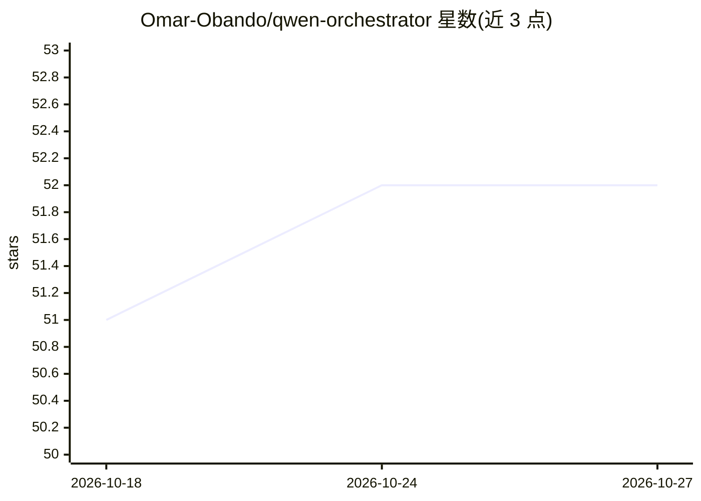

# Omar-Obando/qwen-orchestrator

⭐ 52 · TypeScript · MIT · 推送 2026-06-28 · [GitHub](https://github.com/Omar-Obando/qwen-orchestrator) · [官网](https://qwen.ai/qwencode) · 个人维护 · 中文 README

**Qwen Code CLI 的多 agent 编排扩展：24 个专职 agent 协作开发**

社区开发的 Qwen Code CLI 扩展（非阿里巴巴官方），将单个 AI 编码助手编排为 24 个专职 agent 组成的开发团队（Commander、Planner、前后端开发、Reviewer、QA、DevOps、安全等），配 82 个技能与 6 个斜杠命令。工作流为 CLARIFY→DISCOVER→PLAN→EXECUTE→VERIFY→DELIVER，支持并行执行、MCP Memory Server 持久记忆、循环检测与状态压缩恢复。仅在 Qwen Code CLI 环境运行，不兼容 VS Code/JetBrains 等其他 IDE 集成；模型层面宣称无锁定（Qwen、DeepSeek、OpenAI、Anthropic、本地模型）。通过 qwen extensions install 一条命令安装。

## 筛选速览

| 维度 | 判定 | 备注 |
|---|---|---|
| AI 角色 | `ai-ecosystem` | LLM/agent 周边工具 |
| 许可风险 | `permissive` | MIT |
| 部署形态 | `self-host` | docker 或自建部署 |
| 模型依赖 | — | README 未给出锁定关系 |
| 硬件要求 | — | 无带数字的原话,不猜 |
| 安装摩擦 | `low` | 无编译、无系统依赖或容器化 |
| 成熟度 | — | 结构信号不足 |

## 能力要点

- 24 个专职 agent 与 82 个技能，6 个斜杠命令入口
- 六阶段工作流（澄清/发现/计划/并行执行/验证/交付）
- MCP Memory Server 知识图谱跨会话持久记忆
- 状态写入 .qwen-orchestrator/ 目录，可在上下文压缩后恢复

## 适用场景

- 在 Qwen Code CLI 中用一个命令调度完整开发团队完成建站、API 等任务
- 让 Reviewer 与 QA agent 把控代码质量门禁
- 跨会话保留项目决策与上下文记忆

## 场景标签

`多智能体` `编码 Agent` `Agent 记忆` · 领域:Agent 开发

## 证据(README 行号)

> L11: > 🤖 **The enterprise-grade multi-agent AI orchestration extension exclusively for Qwen Code CLI**
> L23: **Qwen Orchestrator** is a powerful extension built exclusively for **Qwen Code** — the open-source AI coding CLI b
> L37: > ⚠️ **This extension ONLY works with Qwen Code CLI**. It is NOT a standalone tool, NOT a VS Code extension, and NO

## 星数曲线

2026-10-18 51 → 2026-10-27 52（+1）

---
*卡片 v1 · prompt 1.4 · 生成 2026-10-24 · 置信度 mid · 依据 README sha `92964cc5e867` · [字段定义](../../DATASET.md)*
