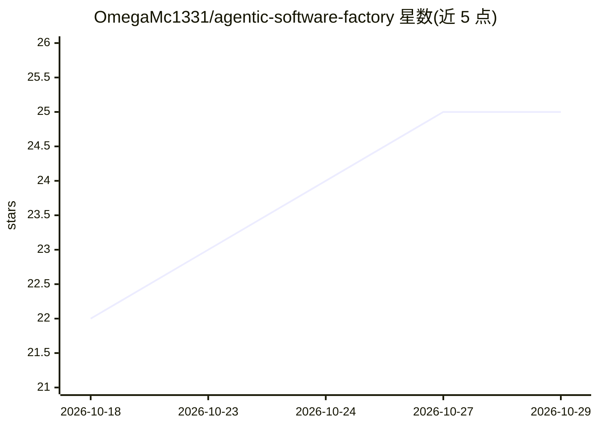

# OmegaMc1331/agentic-software-factory

⭐ 25 · Rust · MIT · 推送 2026-10-26 · [GitHub](https://github.com/OmegaMc1331/agentic-software-factory) · 个人维护

**本地多智能体编码运行时：编排编码 agent 完成规划、审查与集成**

Rust 编写的本地优先多智能体软件工程运行时：用户安装自己的编码 CLI（Codex、Claude Code、OpenCode、Gemini CLI、Qwen Code 等），Factory 将目标或 GitHub Issue 规划为任务 DAG，在隔离 Git worktree 中执行任务，经结构化 Reviewer 审查后将通过的工作集成到 factory/run-<id> 分支并可交付 PR。自身不提供模型、不与模型供应商通信，状态存于本地 .factory/（SQLite）。提供预编译二进制，无需 Rust/Node。限制：worktree 是 Git 隔离而非 OS 沙箱，网络策略为 advisory。

## 筛选速览

| 维度 | 判定 | 备注 |
|---|---|---|
| AI 角色 | `ai-ecosystem` | LLM/agent 周边工具 |
| 许可风险 | `permissive` | MIT |
| 部署形态 | `None` |  |
| 模型依赖 | — | README 未给出锁定关系 |
| 硬件要求 | — | 无带数字的原话,不猜 |
| 安装摩擦 | `low` | 无编译、无系统依赖或容器化 |
| 成熟度 | — | 结构信号不足 |

## 能力要点

- 目标/GitHub Issue → 任务 DAG → worktree 隔离执行 → Reviewer 审查 → 集成分支/PR 的完整流水线
- 八种核心角色与自定义角色，角色、策略、agent 三概念分离
- 本地 SQLite 持久化工作流状态，跨重启保留
- 基于本地历史测量的 agent 路由与性能评估

## 适用场景

- 让多个已有编码 CLI 协作完成一个软件功能并生成 PR
- 从 GitHub Issue 导入并走完整规划-实现-审查-集成流程
- 审计各编码 agent 的首过通过率与集成质量以决定分派

## 场景标签

`多智能体` `编码 Agent` · 领域:Agent 开发

## 证据(README 行号)

> L3: A local multi-agent software engineering runtime that turns an objective or GitHub
> L7: Factory does not provide models. It orchestrates agents.
> L9: You install coding CLIs — Codex, Claude Code, OpenCode, Gemini CLI, Qwen Code, or

## 星数曲线

2026-10-18 22 → 2026-10-29 25（+3）

---
*卡片 v1 · prompt 1.4 · 生成 2026-10-27 · 置信度 high · 依据 README sha `d04f13e7436d` · [字段定义](../../DATASET.md)*
