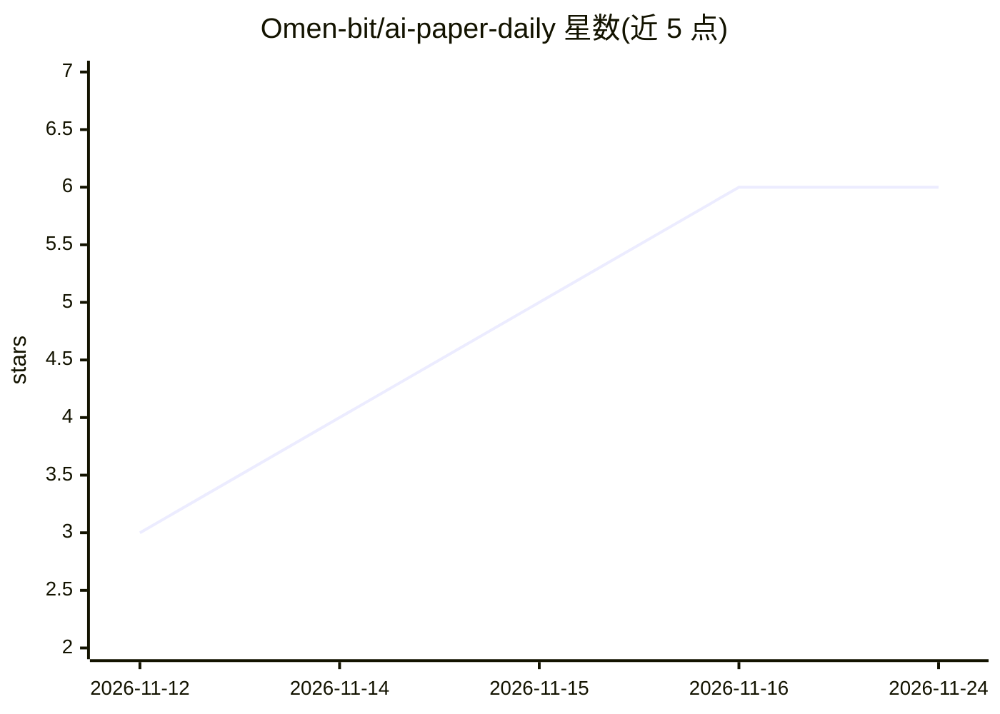

# Omen-bit/ai-paper-daily

⭐ 6 · Python · MIT · 推送 2026-11-23 · [GitHub](https://github.com/Omen-bit/ai-paper-daily) · [官网](https://omen-bit.github.io/ai-paper-daily/) · 个人维护

**每日精选并解读 AI 论文，支持语义搜索与项目找论文**

自动化流水线每天读取 arXiv 上 7 个 ML 类别的全部新论文，按公开信号（GitHub、Hugging Face、Hacker News、Semantic Scholar）的公式选出 top pick 与 trending paper，生成三档深度的通俗解读并发布到 GitHub Pages，同时推送每日邮件与 RSS。附带 8000+ 论文库，支持语义搜索、按实验室浏览、Project Scout 项目匹配论文、趋势图表与个性化推荐。笔记与回答由语言模型生成，README 提示需核对原文；评分排序主要不依赖 LLM。

## 筛选速览

| 维度 | 判定 | 备注 |
|---|---|---|
| AI 角色 | `ai-knowledge` | 知识聚合/清单类 |
| 许可风险 | `permissive` | MIT |
| 部署形态 | `None` |  |
| 模型依赖 | — | README 未给出锁定关系 |
| 硬件要求 | — | 无带数字的原话,不猜 |
| 安装摩擦 | `low` | 无编译、无系统依赖或容器化 |
| 成熟度 | — | 结构信号不足 |

## 能力要点

- 每日自动发布精选版面：1 篇 top pick + 1 篇 trending，含三档深度笔记
- 8000+ 论文的语义搜索与 Project Scout 项目匹配（LangGraph agent）
- 评分公式基于公开信号量化数据，LLM 仅在平分时做对比裁决
- Ask this paper：从全文检索章节回答并引用原句

## 适用场景

- 每天用邮件跟踪值得动手实现的 AI 论文
- 用自然语言描述在 8000+ 论文库里找相关研究
- 为新项目 Scout 匹配可依赖的基础论文
- 查看一年期 AI 研究技术趋势图表

## 场景标签

`语义搜索` `科研工具` · 领域:知识与检索

## 证据(README 行号)

> L28: Behind the picks sits a library of about a year of AI research, **more than 8,000 papers**, that you can search by 
> L96: |`search`|All papers|Finds papers by meaning with vector search|
> L98: |`scout`|Project Scout|A LangGraph agent: splits the project into needs, runs a hybrid search for each, scores ever

## 星数曲线

2026-11-12 3 → 2026-11-24 6（+3）

---
*卡片 v1 · prompt 1.4 · 生成 2026-11-20 · 置信度 high · 依据 README sha `08be5c59238e` · [字段定义](../../DATASET.md)*
