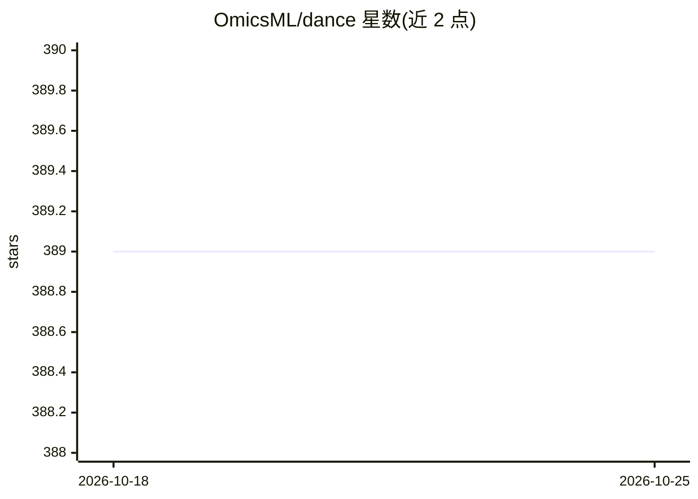

# OmicsML/dance

⭐ 389 · Python · BSD-2-Clause · 推送 2026-10-19 · [GitHub](https://github.com/OmicsML/dance) · [官网](https://pydance.readthedocs.io) · 组织维护 · 中文 README

**面向单细胞分析的深度学习库与基准平台**

DANCE 是 Python 编写的单细胞基因表达数据深度学习工具包：DANCE 1.0 统一实现多种单细胞计算方法（基因插补、细胞类型注释、聚类、多模态组学、空间转录组），提供数据下载、预处理、模型训练与评测的统一工具以复现论文基准；DANCE 2.0 扩展为自动化预处理推荐平台，含方法感知（MAP）本地调优模块与数据感知（DAP）Web 服务。供计算生物学研究者复现实验与比较方法。安装依赖 conda，支持 CPU 与 CUDA 11.8 两种路径。

## 筛选速览

| 维度 | 判定 | 备注 |
|---|---|---|
| AI 角色 | `ai-native` | 本体是模型或模型工具 |
| 许可风险 | `permissive` | BSD-2-Clause |
| 部署形态 | `library` | 以包/库形式分发 |
| 模型依赖 | — | README 未给出锁定关系 |
| 硬件要求 | — | 无带数字的原话,不猜 |
| 安装摩擦 | `medium` | 含编译或系统依赖之一 |
| 成熟度 | — | 结构信号不足 |

## 能力要点

- 统一实现多种单细胞计算方法（插补/注释/聚类/多模态/空间转录组）
- 提供数据下载、预处理、训练、评测一体化基准复现工具
- DANCE 2.0 的 MAP 模块自动构建预处理流水线，DAP Web 服务给出数据集级推荐
- 含已发表论文（Genome Biology、ACM TIST）与基准性能表格

## 适用场景

- 复现已发表论文中的单细胞分析实验结果
- 在统一框架下比较不同单细胞计算方法的基准表现
- 为新数据集自动选择预处理流水线

## 场景标签

`模型评测` · 领域:评测与运维

## 证据(README 行号)

> L16: **DANCE 1.0** is a Python toolkit designed to support deep learning models for large-scale analysis of single-cell 
> L89: DANCE addresses these challenges by providing a unified Python package implementing many popular computational sing
> L113: In release 2.0, DANCE evolves from an experiment reproduction library into an automated and interpretable preproce

## 星数曲线

2026-10-18 389 → 2026-10-25 389（+0）

---
*卡片 v1 · prompt 1.4 · 生成 2026-10-21 · 置信度 high · 依据 README sha `2a9f951537e4` · [字段定义](../../DATASET.md)*
