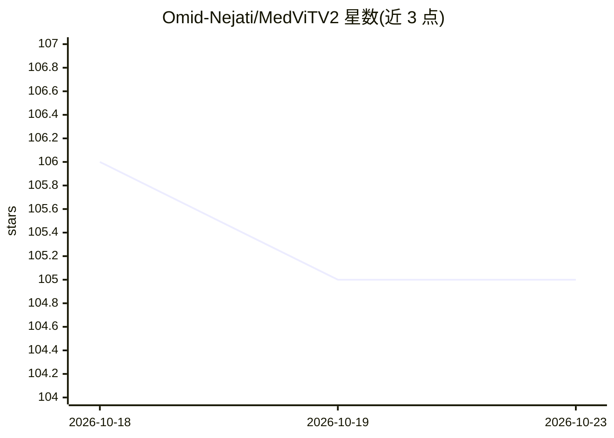

# Omid-Nejati/MedViTV2

⭐ — · [GitHub]() · 组织维护

**医学影像分类模型：KAN 集成 Transformer 与膨胀邻域注意力**

MedViTV2 是面向医学影像分类的视觉 Transformer 架构，首次将 Kolmogorov–Arnold Network（KAN）层集成进 Transformer，并提出膨胀邻域注意力（DiNA）与局部/全局特征感知模块的层级混合策略。提供 tiny/small/base/large 四种规格与预训练权重，在 MedMNIST 等 17 个分类数据集与 12 个损坏数据集上训练和评估，并支持训练所有 TIMM 模型。以 PyTorch 代码库形式提供，含 Colab 教程与 Grad-CAM 可视化脚本，论文发表于 Applied Soft Computing 2025。

## 筛选速览

| 维度 | 判定 | 备注 |
|---|---|---|
| AI 角色 | `ai-native` | 本体是模型或模型工具 |
| 许可风险 | `permissive` | — |
| 部署形态 | `library` | 以包/库形式分发 |
| 模型依赖 | — | README 未给出锁定关系 |
| 硬件要求 | — | 无带数字的原话,不猜 |
| 安装摩擦 | `medium` | 含编译或系统依赖之一 |
| 成熟度 | — | 结构信号不足 |

## 能力要点

- KAN 层集成进 Transformer，配合 DiDA 膨胀邻域注意力
- 提供 tiny/small/base/large 四种规格及预训练权重
- 覆盖 17 个医学分类数据集与 12 个损坏数据集的评估
- 附带 Grad-CAM 热图可视化教程，支持训练所有 TIMM 模型

## 适用场景

- 在 MedMNIST 等医学影像数据集上训练或微调分类模型
- 下载预训练权重直接做医学影像分类推理
- 用 Grad-CAM 可视化模型关注的图像区域做分析

## 场景标签

 · 领域:医学影像/深度学习

## 证据(README 行号)

> L6:  MedViTV2: Medical Image Classification with KAN-Integrated Transformers and Dilated Neighborhood Attention
> L19: Convolutional networks, transformers, hybrid models, and Mamba-based architectures have shown strong performance in

## 星数曲线

2026-10-18 106 → 2026-10-23 105（-1）

---
*卡片 v1 · prompt 1.4 · 生成 2026-10-23 · 置信度 mid · 依据 README sha `16eebb66f2ad` · [字段定义](../../DATASET.md)*
