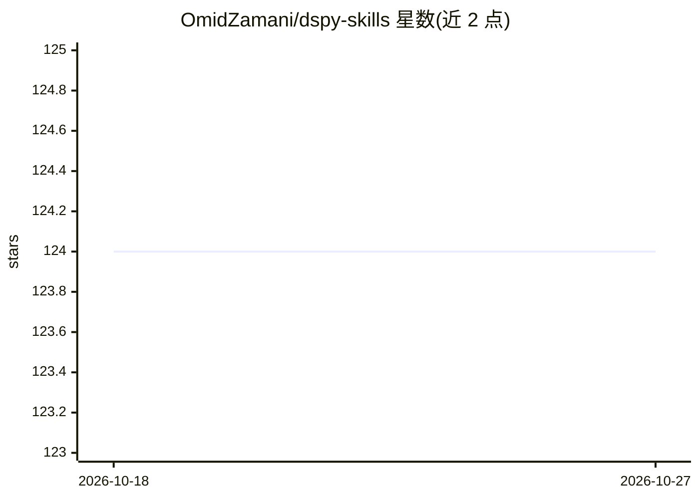

# OmidZamani/dspy-skills

⭐ 124 · Python · MIT · 推送 2026-06-23 · [GitHub](https://github.com/OmidZamani/dspy-skills) · 个人维护

**面向 Claude Code 的 DSPy 开发技能插件（22 个技能）**

包含 22 个技能的 Claude Code 插件，覆盖用 DSPy 框架开发 LLM 应用的环节：签名与模块设计、RAG 与多跳检索管线、ReAct 智能体与 MCP 工具集成、优化器选择（MIPROv2/GEPA/SIMBA 等）、生产部署与调试可观测性。以 Claude Code 插件市场命令安装，依赖 DSPy 3.2.1 稳定版（3.3.0b1 为预发布）。供使用 DSPy 构建、优化和部署 LLM 应用的开发者使用。

## 筛选速览

| 维度 | 判定 | 备注 |
|---|---|---|
| AI 角色 | `ai-ecosystem` | LLM/agent 周边工具 |
| 许可风险 | `permissive` | MIT |
| 部署形态 | `library` | 以包/库形式分发 |
| 模型依赖 | — | README 未给出锁定关系 |
| 硬件要求 | — | 无带数字的原话,不猜 |
| 安装摩擦 | `low` | 无编译、无系统依赖或容器化 |
| 成熟度 | — | 结构信号不足 |

## 能力要点

- 22 个技能覆盖 DSPy 签名设计、RAG、智能体、优化器与部署
- 按 Start Here / 检索数据 / 智能体推理 / 优化器 / 生产接口五类组织
- 提供从签名定义到优化器选择再到生产加固的典型工作流
- 通过 Claude Code 插件市场命令安装

## 适用场景

- 在 Claude Code 中获得 DSPy 框架的开发指导技能
- 为 DSPy 管线选择合适的提示优化器
- 搭建并加固 RAG 管线与 ReAct 智能体

## 场景标签

`提示工程` · 领域:Agent 开发

## 证据(README 行号)

> L3: A Claude Code plugin containing 22 focused skills for programming, optimizing, evaluating, and deploying LLM applica
> L62: ## Typical Workflow

## 星数曲线

2026-10-18 124 → 2026-10-27 124（+0）

---
*卡片 v1 · prompt 1.4 · 生成 2026-10-23 · 置信度 mid · 依据 README sha `73279c5ae72f` · [字段定义](../../DATASET.md)*
