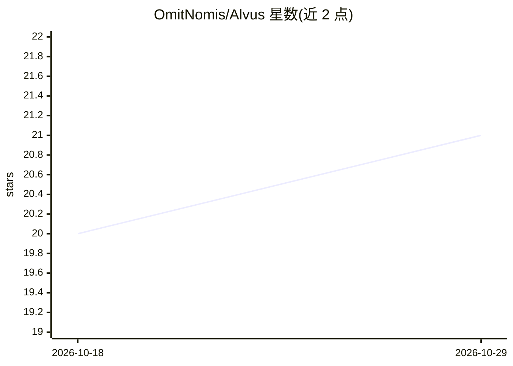

# OmitNomis/Alvus

⭐ 21 · Go · MIT · 推送 2026-08-05 · [GitHub](https://github.com/OmitNomis/Alvus) · 个人维护

**零依赖 Go 代理：轮换免费档 AI API 密钥池，消除 429**

用 Go 标准库编写的单二进制 API 代理，部署在 agent/IDE 与上游 OpenAI 兼容 API 之间：维护多个密钥的密钥池，按轮询分发请求，429/502/503 时静默重试并给密钥加冷却，401/403 密钥进入隔离与递增退避重探，支持 RPM 主动限速、流式透传、/health 与 /dashboard 管理面板，并可把 Anthropic Messages API 双向翻译为 OpenAI 格式使 Claude Code 接入任意后端。默认仅绑定 127.0.0.1，LAN 暴露需管理员令牌。需 Go 1.21+ 从源码构建或下载预编译版本。

## 筛选速览

| 维度 | 判定 | 备注 |
|---|---|---|
| AI 角色 | `ai-ecosystem` | LLM/agent 周边工具 |
| 许可风险 | `permissive` | MIT |
| 部署形态 | `library` | 以包/库形式分发 |
| 模型依赖 | — | README 未给出锁定关系 |
| 硬件要求 | — | 无带数字的原话,不猜 |
| 安装摩擦 | `low` | 无编译、无系统依赖或容器化 |
| 成熟度 | — | 结构信号不足 |

## 能力要点

- 多密钥轮询池：429 静默重试、密钥冷却与隔离退避重探
- RPM_LIMIT 主动限速（滚动 60 秒窗口按密钥配额放行）
- Anthropic ⇄ OpenAI 双向翻译模式，支持工具调用与流式 SSE
- 纯 Go stdlib 单二进制，~2 MB 空闲内存，含 /dashboard 管理面板

## 适用场景

- 免费档密钥（如 NVIDIA NIM）频繁触发 429 时保持 agent 会话不断
- 让 Cline、Cursor、Aider 等 OpenAI 兼容客户端共享一个密钥池端点
- 让 Claude Code 运行在 OpenAI 兼容后端上

## 场景标签

`模型网关` · 领域:Agent 开发

## 证据(README 行号)

> L28: Alvus sits between your agent and the upstream API. You give it a pool of keys. It handles everything else — round-
> L31: Any OpenAI-compatible agent or IDE
> L43: If it speaks OpenAI-compatible API, it works with Alvus.

## 星数曲线

2026-10-18 20 → 2026-10-29 21（+1）

---
*卡片 v1 · prompt 1.4 · 生成 2026-10-28 · 置信度 high · 依据 README sha `fe9167f093f2` · [字段定义](../../DATASET.md)*
