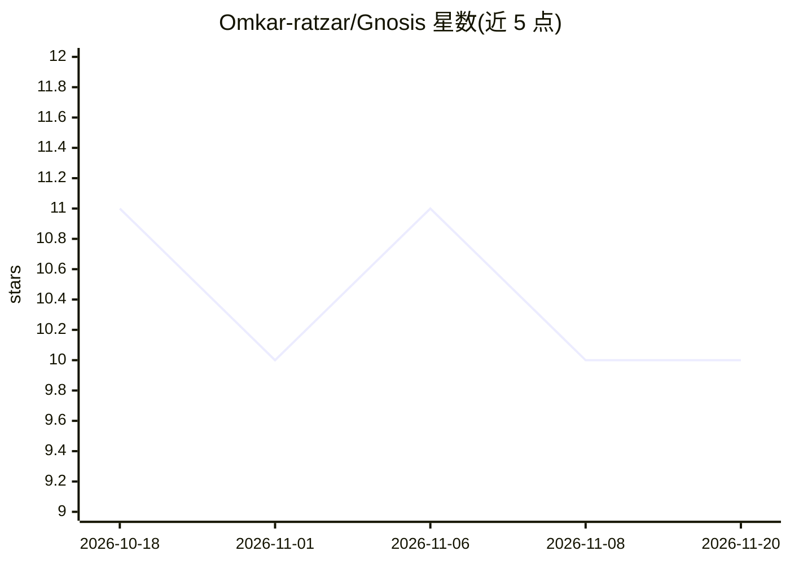

# Omkar-ratzar/Gnosis

⭐ 10 · Python · MIT · 推送 2026-07-16 · [GitHub](https://github.com/Omkar-ratzar/Gnosis) · 个人维护

**基于 Airflow 编排的文档/图像语义搜索管线**

以 Apache Airflow 编排的非结构化数据语义搜索管线：文件经 FastAPI 上传后，进入文档与图像两条 DAG 管线。文档侧支持 PDF/DOCX/PPTX/TXT 抽取、分块并用 BGE 模型生成向量；图像侧用本地运行的 MiniCPM-V（经 Ollama）生成结构化描述并提取 EXIF。向量存入 Qdrant，元数据存 PostgreSQL，通过 /api/search 提供 API 与网页界面检索。需要 Python 3.11+、PostgreSQL、Airflow、Qdrant、Ollama 与 Docker Compose 运行。

## 筛选速览

| 维度 | 判定 | 备注 |
|---|---|---|
| AI 角色 | `ai-native` | 本体是模型或模型工具 |
| 许可风险 | `permissive` | MIT |
| 部署形态 | `self-host` | docker 或自建部署 |
| 模型依赖 | local-ok | 支持本地模型 |
| 硬件要求 | `cpu-ok` | |
| 安装摩擦 | `low` | 无编译、无系统依赖或容器化 |
| 成熟度 | — | 结构信号不足 |

## 能力要点

- Apache Airflow DAG 编排的文档与图像两条处理管线
- BAAI/bge-small-en-v1.5 生成嵌入，Qdrant 做向量检索
- MiniCPM-V 本地生成图像结构化描述，附带 EXIF 提取
- FastAPI 后端 + 静态网页界面的上传与搜索交互

## 适用场景

- 把散落的文档和图片自动建立索引做语义搜索
- 本地搭建不依赖人工打标的知识库检索
- 用 Airflow 监控数据处理管线的运行状态

## 场景标签

`语义搜索` `文档解析` · 领域:知识与检索

## 证据(README 行号)

> L3: A Next-Generation Multimodal Semantic Search Pipeline Orchestrated with Apache Airflow.
> L41: - Maps raw text blocks into dense vector spaces using (`BAAI/bge-small-en-v1.5`).
> L46: - Cosine-similarity searches pushed live over our search API endpoints (`/api/search`).

## 星数曲线

2026-10-18 11 → 2026-11-20 10（-1）

---
*卡片 v1 · prompt 1.4 · 生成 2026-11-20 · 置信度 high · 依据 README sha `c3ca7da87ae3` · [字段定义](../../DATASET.md)*
