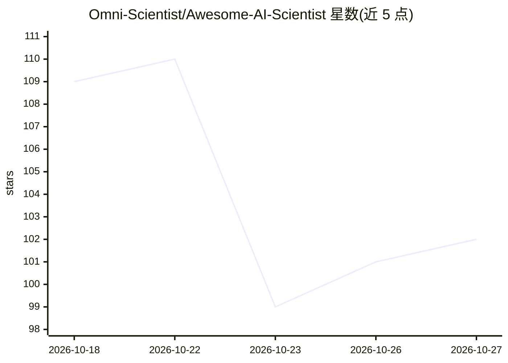

# Omni-Scientist/Awesome-AI-Scientist

⭐ 102 · Python · NOASSERTION · 推送 2026-10-24 · [GitHub](https://github.com/Omni-Scientist/Awesome-AI-Scientist) · [官网](https://omni-scientist.github.io/Awesome-AI-Scientist/) · 组织维护

**AI 科学家论文/系统/基准/数据集的策展清单**

聚合 AI 自动化科研（AI Scientist）领域的资源清单：按端到端 AI 科学家系统、协作科学家与研究 agent、可运行的开源工作台（端到端平台/文献与深度研究平台/实验室自动化）、基准、数据集与学习资源分类，条目附论文、代码、Daily Papers 徽章与网站链接，覆盖化学、生物、材料、ML 工程等学科，2026-08 首次发布并持续接受 PR。

## 筛选速览

| 维度 | 判定 | 备注 |
|---|---|---|
| AI 角色 | `ai-knowledge` | 知识聚合/清单类 |
| 许可风险 | `none` | NOASSERTION |
| 部署形态 | `None` |  |
| 模型依赖 | — | README 未给出锁定关系 |
| 硬件要求 | — | 无带数字的原话,不猜 |
| 安装摩擦 | `low` | 无编译、无系统依赖或容器化 |
| 成熟度 | — | 结构信号不足 |

## 能力要点

- 三类大板块：系统/协作科学家/可运行工作台，细分端到端、深度研究、实验室自动化等
- 条目统一附论文、代码、Daily Papers 徽章与网站链接
- 开源工作台板块限定为可 clone 并运行的平台

## 适用场景

- 查找自动化科研 agent 系统的论文与开源实现
- 比较可本地运行的科研工作台平台
- 跟踪 AI for Science 基准与数据集

## 场景标签

`精选清单` · 领域:学习与行业

## 证据(README 行号)

> L5: > Papers, systems, benchmarks, datasets and leaderboards for AI that does science.
> L17: 🔬 Systems · 🧰 Workbenches you can run · 📊 Benchmarks · 📦 Data & environments · 🎓 Learning resources

## 星数曲线

2026-10-18 109 → 2026-10-27 102（-7）

---
*卡片 v1 · prompt 1.4 · 生成 2026-10-23 · 置信度 high · 依据 README sha `4f6cd75df3cc` · [字段定义](../../DATASET.md)*
