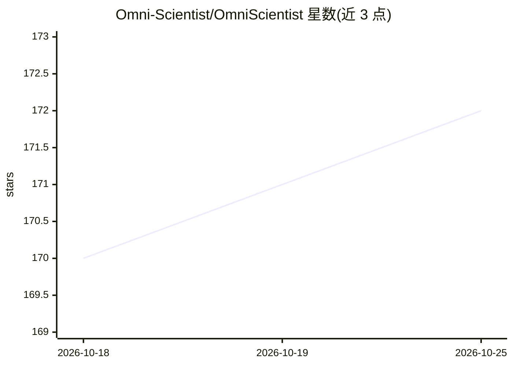

# Omni-Scientist/OmniScientist

⭐ 172 · TypeScript · MIT · 推送 2026-09-26 · [GitHub](https://github.com/Omni-Scientist/OmniScientist) · [官网](https://omni-scientist.github.io/) · 组织维护 · 中文 README

**本地运行的全模态 AI 科学家：自动完成科研并产出论文**

面向科研自动化的桌面应用与引擎：用户指定数据文件夹与研究方向后，系统自行查看原始数据、形成假设、编写并运行分析代码、读取产出的图表，最终生成一份编译为 PDF 的论文，其中每个数字可回溯到真实执行记录。采用双模型分工：主干模型负责推理与写作，感知侧车模型处理图像、波形、视频、点云等证据。桌面版为本地 Web 应用，另提供 Claude Code skill 与参考引擎；论文引用通过 OpenAlex/Crossref 实时解析为真实 DOI。0.2.1 起 CLI 版停更，由桌面版承接。

## 筛选速览

| 维度 | 判定 | 备注 |
|---|---|---|
| AI 角色 | `ai-native` | 本体是模型或模型工具 |
| 许可风险 | `permissive` | MIT |
| 部署形态 | `desktop` | 安装包/桌面程序 |
| 模型依赖 | local-ok | 支持本地模型 |
| 硬件要求 | — | 无带数字的原话,不猜 |
| 安装摩擦 | `low` | 无编译、无系统依赖或容器化 |
| 成熟度 | `idea` | |

## 能力要点

- 从假设到编译 PDF 的端到端自动科研流程
- 论文中每个数字回链到产生它的执行记录（stdout 校验门）
- 图像/波形/音频/视频/点云等多模态输入直接进入分析
- 双模型架构：主干推理 + 感知侧车，支持 OpenAI 兼容端点与本地 vLLM/sglang

## 适用场景

- 我想让 AI 基于本地数据自主完成一项研究并生成可溯源论文
- 科研团队用参考引擎做可复现、可脚本化的实验运行
- 在 Claude Code 中以 skill 形式调用该科研引擎

## 场景标签

`科研工具` `多模态` `编码 Agent` · 领域:编码与开发

## 证据(README 行号)

> L44: Point OmniScientist at a folder of data and a research direction. It looks at the raw material itself, forms a hypo
> L79: Every number in the draft carries a link back to the run that produced it. A gate reads the execution record rather
> L92: Two models do two jobs. The backbone reasons and writes. A perception sidecar reads the pixels, and takes over when

## 星数曲线

2026-10-18 170 → 2026-10-25 172（+2）

---
*卡片 v1 · prompt 1.4 · 生成 2026-10-23 · 置信度 mid · 依据 README sha `7220ddc87fc1` · [字段定义](../../DATASET.md)*
