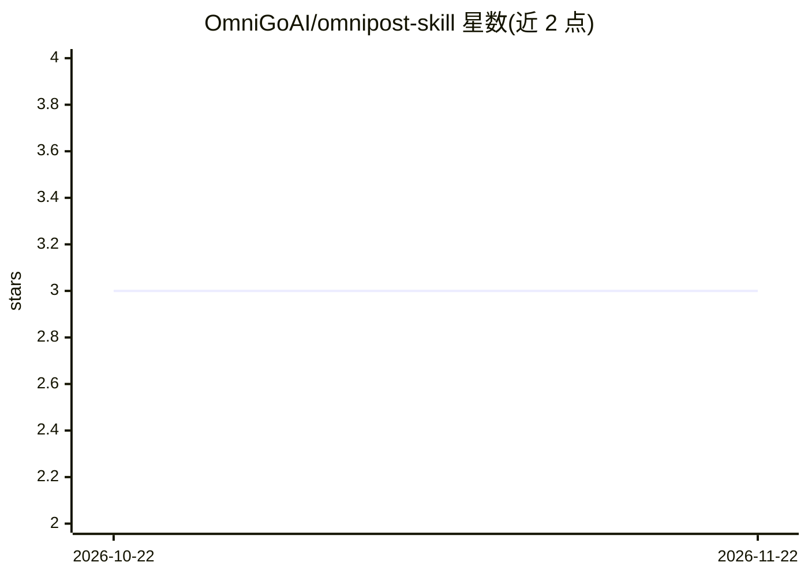

# OmniGoAI/omnipost-skill

⭐ 3 · JavaScript · MIT · 推送 2026-10-23 · [GitHub](https://github.com/OmniGoAI/omnipost-skill) · [官网](https://omnigoai.com/zh/products/omnipost/)

**让 AI 代理一条命令发布内容到 40+ 平台的技能**

本仓库是一个面向 Claude Code / OpenClaw / Codex 等代理的技能包：SKILL.md 描述如何调用本机 OmniPost 桌面应用的 CLI/MCP（44 个工具）完成多平台发布，附 10 个中文平台的内容红线规则速查、发布 JSON 与脚本示例。OmniPost 应用本身闭源、免费+付费（免费版限 8 平台、3 账号、每月 30 篇），账号登录态存本机、不经云端中转，默认进草稿箱。接入方式为把 skills 目录复制进代理的 skills 目录，或经 npm 安装 MCP 工具。

## 筛选速览

| 维度 | 判定 | 备注 |
|---|---|---|
| AI 角色 | `ai-knowledge` | 知识聚合/清单类 |
| 许可风险 | `permissive` | MIT |
| 部署形态 | `library` | 以包/库形式分发 |
| 模型依赖 | — | README 未给出锁定关系 |
| 硬件要求 | — | 无带数字的原话,不猜 |
| 安装摩擦 | `low` | 无编译、无系统依赖或容器化 |
| 成熟度 | — | 结构信号不足 |

## 能力要点

- 一条命令发布到 41 个平台（中文图文/视频 + 海外官方 API）
- 44 个 MCP 工具与 CLI 命令对照，平台参数返回机器可读清单
- 10 个中文平台内容规则速查，附官方条款编号与来源链接
- 账号登录态存本机独立会话分区，不经云端中转

## 适用场景

- 让 Claude Code 写完技术文章后一键发知乎、CSDN、公众号
- 内容矩阵运营前按平台红线检查并调整稿件
- 在多个 agent 客户端中复用同一套发布技能

## 场景标签

`工作流自动化` · 领域:效率与自动化

## 证据(README 行号)

> L3: **让 Claude Code / OpenClaw / Codex 等 AI 代理，用一条命令把写好的内容发到 40 多个平台。**
> L29: - `skills/omnipost/SKILL.md` —— 技能本体：如何找到本机 OmniPost、CLI 速查、44 个 MCP 工具与 CLI 命令对照、发布工作流、写法规格、运营巡检、约定。
> L30: - `skills/omnipost/rules/` —— **10 个中文平台的内容规则速查**（小红书、公众号、抖音、快手、视频号、B站、微博、百家号、头条号、知乎），每条红线附官方条款编号与来源链接。agent 发布前按平台

## 星数曲线

2026-10-22 3 → 2026-11-22 3（+0）

---
*卡片 v1 · prompt 1.4 · 生成 2026-11-22 · 置信度 high · 依据 README sha `98a94af0cf28` · [字段定义](../../DATASET.md)*
