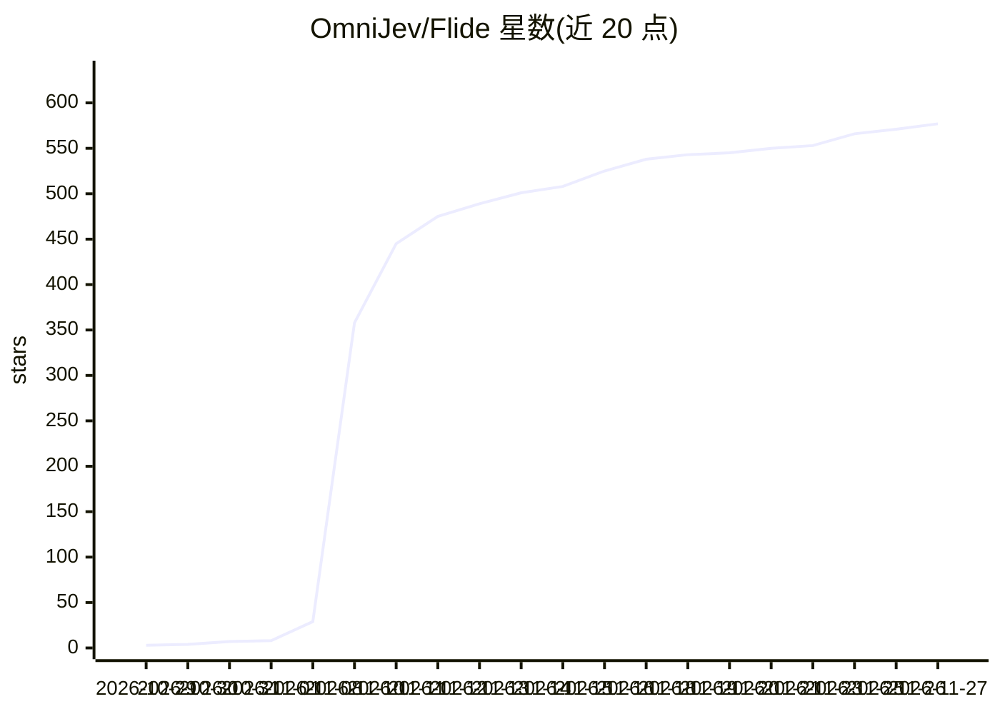

# OmniJev/Flide

⭐ 577 · Python · Apache-2.0 · 推送 2026-11-26 · [GitHub](https://github.com/OmniJev/Flide) · [官网](https://flide.org) · 组织维护

**面向 Jev 决策模型的推理引擎：状态分叉加速多问题批量推断**

为 Jev 风格决策模型提供的推理基础设施，核心机制为 exact state forking——一个状态分叉给多个问题，每个问题一次前向传播即得答案，提供 Jev 的 /v1/systemone API。以 PyPI 包和 Docker 镜像分发，运行于 Linux 或 Windows WSL2 下的 NVIDIA GPU。支持 Qwen2.5/Qwen3/Qwen3.5、Gemma 4 等聊天模型及数十个决策模型家族，带 LoRA 适配、FP8/int8 量化、会话缓存、张量并行等选项，README 附 arXiv 论文引用信息。

## 筛选速览

| 维度 | 判定 | 备注 |
|---|---|---|
| AI 角色 | `ai-ecosystem` | LLM/agent 周边工具 |
| 许可风险 | `permissive` | Apache-2.0 |
| 部署形态 | `self-host` | docker 或自建部署 |
| 模型依赖 | — | README 未给出锁定关系 |
| 硬件要求 | — | 无带数字的原话,不猜 |
| 安装摩擦 | `low` | 无编译、无系统依赖或容器化 |
| 成熟度 | — | 结构信号不足 |

## 能力要点

- exact state forking：一个状态分叉多问题，每问一次前向传播
- 提供 Jev /v1/systemone API，单请求支持最多 256 个选项
- 支持 FP8/int8 量化、会话缓存、批量不变模式与多前端进程
- 支持数十个决策模型家族及文本/图像/视频输入

## 适用场景

- 对大量邮件等条目按多套问题批量做决策打标
- Agent 场景中多步推理复用已缓存状态
- 部署 Jev 决策模型的推理服务

## 场景标签

`推理引擎` · 领域:训练与推理

## 证据(README 行号)

> L15: Flide is fast inference infrastructure for Jev-style decision models. With exact state forking it is up to 9.5 time
> L52: Flide runs on an NVIDIA GPU under Linux or Windows WSL2. Install it with uv, or pull the Docker image.
> L55: uv pip install flide

## 星数曲线

2026-10-29 3 → 2026-11-27 577（+574）

---
*卡片 v1 · prompt 1.4 · 生成 2026-11-27 · 置信度 high · 依据 README sha `4bf05fbba42a` · [字段定义](../../DATASET.md)*
