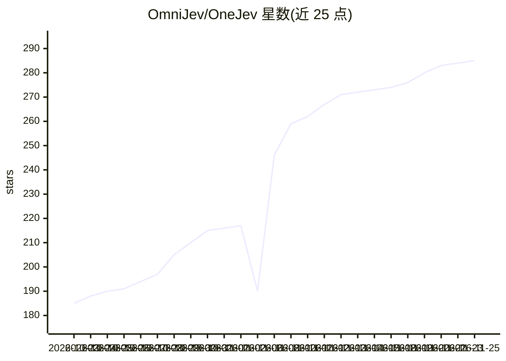

# OmniJev/OneJev

⭐ 285 · Python · Apache-2.0 · 推送 2026-11-23 · [GitHub](https://github.com/OmniJev/OneJev) · [官网](https://omnijev.github.io/OneJev/) · 组织维护

**基于 Qwen 的多模态决策模型：一次前向输出校准概率**

OneJev 是基于 Qwen 的多模态 System One 决策模型，对屏幕截图、照片、视频与文本的类型化问题返回校准概率，单次前向完成，提供 0.8B/4B/9B/27B 四种规模。运行时可选自研推理引擎 Flide（NVIDIA GPU，支持视频）、llama.cpp（GGUF，文本与图像）或 Docker Compose 一键栈（自动检测硬件，torch/rocm/vulkan/gguf/cpu 等后端）；API 与 TypeSafe System One 兼容。附带训练数据集 OneJev-Data（公开 94,707 条问题）与微调配置，支持多 GPU/FSDP 训练。Apache 2.0 许可。

## 筛选速览

| 维度 | 判定 | 备注 |
|---|---|---|
| AI 角色 | `ai-native` | 本体是模型或模型工具 |
| 许可风险 | `permissive` | Apache-2.0 |
| 部署形态 | `library` | 以包/库形式分发 |
| 模型依赖 | local-ok | 支持本地模型 |
| 硬件要求 | — | 无带数字的原话,不猜 |
| 安装摩擦 | `low` | 无编译、无系统依赖或容器化 |
| 成熟度 | — | 结构信号不足 |

## 能力要点

- 单次前向输出校准概率（yes 概率、各选项概率、期望等级）
- 0.8B/4B/9B/27B 四种规模，Hugging Face 与 ModelScope 发布
- 三种运行后端：Flide、llama.cpp、Docker Compose 自动检测硬件
- 公开训练数据集与多 GPU/FSDP 微调配置

## 适用场景

- 对截图/界面进行类型化判断并获取概率输出
- 本地部署多模态决策模型服务（API 于 :8000）
- 用公开数据集微调自有规模的决策模型

## 场景标签

`多模态` `微调` `推理引擎` · 领域:感知与多模态

## 证据(README 行号)

> L17: OneJev is a multimodal System One decision model based on Qwen. It returns calibrated probabilities for
> L18: typed questions about screenshots, photos, videos and text in a single forward pass. Available in 0.8B, 4B, 9B and 
> L45: Choose one backend, then run the Python example below.

## 星数曲线

2026-10-23 185 → 2026-11-25 285（+100）

---
*卡片 v1 · prompt 1.4 · 生成 2026-11-25 · 置信度 high · 依据 README sha `7fb684366e12` · [字段定义](../../DATASET.md)*
