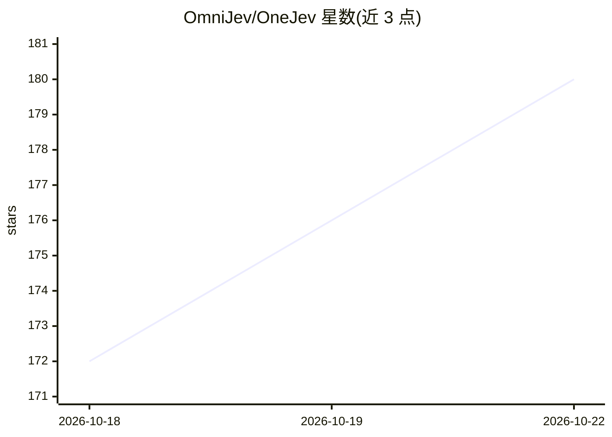

# OmniJev/OneJev

⭐ 180 · Python · Apache-2.0 · 推送 2026-10-21 · [GitHub](https://github.com/OmniJev/OneJev) · [官网](https://omnijev.github.io/OneJev/) · 组织维护 · 中文 README

**多模态决策模型：对屏幕/图片/视频/文本给出校准概率答案**

基于 Qwen 的多模态 System One 决策模型，提供 0.8B/4B/9B/27B 四个规模：对截图、照片、视频与文本的类型化问题，单次前向返回校准的答案概率。运行方式包括 PyTorch 后端（NVIDIA GPU，支持文本/图像/视频）、llama.cpp GGUF 后端（文本/图像）及自动检测硬件的 Docker Compose 栈，均在 :8000 提供 API 与 playground。附训练流程：开放 94,707 条训练问题，各规模基于 Qwen3.5/Qwen3.8 微调一 epoch，9B/27B 配置启用 FSDP。Apache 2.0 许可。

## 筛选速览

| 维度 | 判定 | 备注 |
|---|---|---|
| AI 角色 | `ai-native` | 本体是模型或模型工具 |
| 许可风险 | `permissive` | Apache-2.0 |
| 部署形态 | `library` | 以包/库形式分发 |
| 模型依赖 | local-ok | 支持本地模型 |
| 硬件要求 | — | 无带数字的原话,不猜 |
| 安装摩擦 | `low` | 无编译、无系统依赖或容器化 |
| 成熟度 | — | 结构信号不足 |

## 能力要点

- 单次前向输出校准概率，四个模型规模（0.8B–27B）
- 三种后端可选：PyTorch / llama.cpp GGUF / Docker Compose 自动检测
- 提供训练数据（94,707 条）与微调配置，支持 FSDP 多卡训练
- 提供在线 Demo 与 Hugging Face / ModelScope 权重

## 适用场景

- 对 GUI 截图做类型化决策判断并获取置信度
- 为 agent 的 computer-use 场景提供校准的概率决策
- 在自有数据上微调并部署自己的决策模型

## 场景标签

`多模态` `微调` · 领域:感知与多模态

## 证据(README 行号)

> L17: OneJev is a multimodal System One decision model based on Qwen. It returns calibrated probabilities for
> L18: typed questions about screenshots, photos, videos and text in a single forward pass. Available in 0.8B, 4B, 9B and 

## 星数曲线

2026-10-18 172 → 2026-10-22 180（+8）

---
*卡片 v1 · prompt 1.4 · 生成 2026-10-22 · 置信度 high · 依据 README sha `c809244e0951` · [字段定义](../../DATASET.md)*
