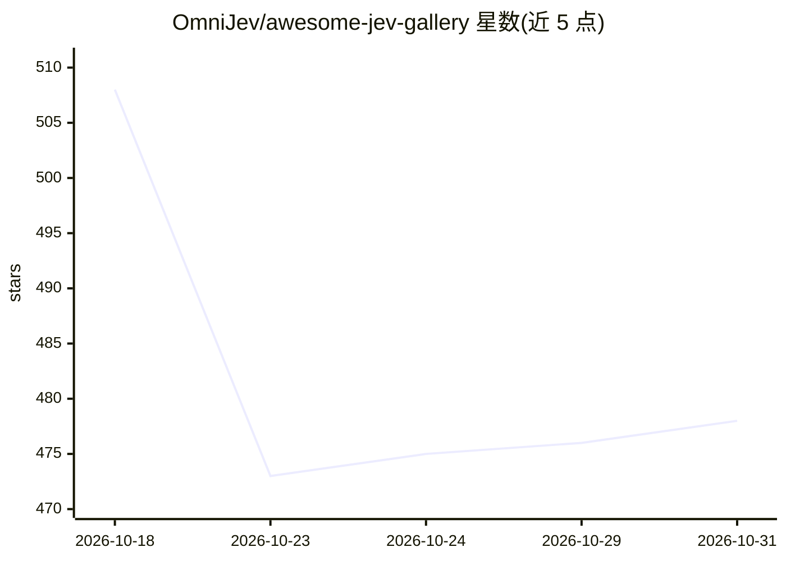

# OmniJev/awesome-jev-gallery

⭐ 478 · Python · NOASSERTION · 推送 2026-10-30 · [GitHub](https://github.com/OmniJev/awesome-jev-gallery) · [官网](https://omnijev.github.io/awesome-jev-gallery/) · 组织维护

**Jev/System One 模型的论文、开源模型与评测策展清单**

围绕 TypeSafe 的 System One 模型与 Jev 的生态聚合清单：收录发布文章与文档、开源复现模型（0.8B 到 35B 的 RLCD 微调、决策头、并行解码实现）、以 Jev 契约构建的软件（路由器、代理、机器人控制、交易系统）、基准与排行榜及评论。条目多为第三方独立项目，标注许可证与作者自报的评测数字，接受 PR 贡献。条目按官方发布、开源、Built with Jev 等板块组织。

## 筛选速览

| 维度 | 判定 | 备注 |
|---|---|---|
| AI 角色 | `ai-knowledge` | 知识聚合/清单类 |
| 许可风险 | `none` | NOASSERTION |
| 部署形态 | `None` |  |
| 模型依赖 | — | README 未给出锁定关系 |
| 硬件要求 | — | 无带数字的原话,不猜 |
| 安装摩擦 | `low` | 无编译、无系统依赖或容器化 |
| 成熟度 | — | 结构信号不足 |

## 能力要点

- 覆盖论文、开源模型、基准与排行榜四类条目
- 收录数十个 Jev 形状的开源复现模型（含 Apache-2.0 与非商业许可标注）
- 含 Built with Jev 板块：代理、机器人控制、交易系统等集成项目
- 接受 PR 贡献并持续更新（新增 14 个项目、benchmark 板块）

## 适用场景

- 查找 Jev/System One 形状的开源复现模型与权重
- 对比各复现项目在 JevBench 等基准上的自报成绩
- 了解 System One 生态的论文、工具与集成项目全貌

## 场景标签

`精选清单` · 领域:学习与行业

## 证据(README 行号)

> L5: > Papers, open models and evaluations behind System One models and Jev.
> L40: ## 🧪 Open Source

## 星数曲线

2026-10-18 508 → 2026-10-31 478（-30）

---
*卡片 v1 · prompt 1.4 · 生成 2026-10-21 · 置信度 high · 依据 README sha `ef0af52f326e` · [字段定义](../../DATASET.md)*
