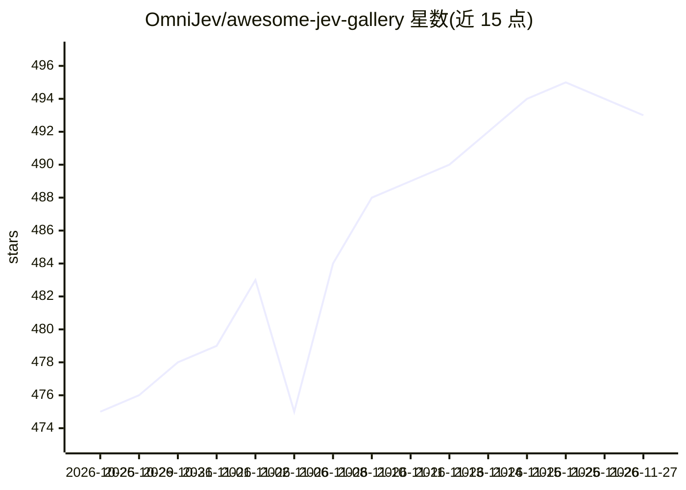

# OmniJev/awesome-jev-gallery

⭐ 493 · Python · NOASSERTION · 推送 2026-11-26 · [GitHub](https://github.com/OmniJev/awesome-jev-gallery) · [官网](https://omnijev.github.io/awesome-jev-gallery/) · 个人维护

**Jev/System One 模型的论文、开源实现与评测清单**

围绕 TypeSafe 发布的 System One 模型与 Jev 接口的聚合清单：收录官方发布资料、开源权重与代码实现（OneJev、Flide、各规模 RLCD 决策模型）、基准与排行榜，以及基于 Jev 构建的路由、agent、游戏与集成项目。条目以表格形式列出，每条附代码、模型权重或网站链接，并记录作者自报的性能与评测数据。面向关注决策模型与校准概率的研究者与开发者，通过 GitHub PR 接受新增条目。

## 筛选速览

| 维度 | 判定 | 备注 |
|---|---|---|
| AI 角色 | `ai-knowledge` | 知识聚合/清单类 |
| 许可风险 | `none` | NOASSERTION |
| 部署形态 | `None` |  |
| 模型依赖 | — | README 未给出锁定关系 |
| 硬件要求 | — | 无带数字的原话,不猜 |
| 安装摩擦 | `low` | 无编译、无系统依赖或容器化 |
| 成熟度 | — | 结构信号不足 |

## 能力要点

- 收录开源决策模型实现，覆盖 0.6B 至 27B 多种规模
- 包含官方 System One Adapter 与第三方兼容接口（/v1/systemone）
- 设有 Benchmark & Leaderboard 板块与论文专列 Awesome JEV Papers
- 条目标注许可证、推理时延与作者自报评测指标

## 适用场景

- 查找 Jev 兼容的开源决策模型与权重
- 调研 System One 架构的论文与训练方法
- 对比各实现的自报评测结果与推理速度

## 场景标签

`精选清单` · 领域:学习与行业

## 证据(README 行号)

> L3: # Awesome JEV Awesome
> L40: ## 🧪 Open Source
> L97: ## 🔧 Built with Jev

## 星数曲线

2026-10-25 475 → 2026-11-27 493（+18）

---
*卡片 v1 · prompt 1.4 · 生成 2026-11-25 · 置信度 high · 依据 README sha `536169de692a` · [字段定义](../../DATASET.md)*
