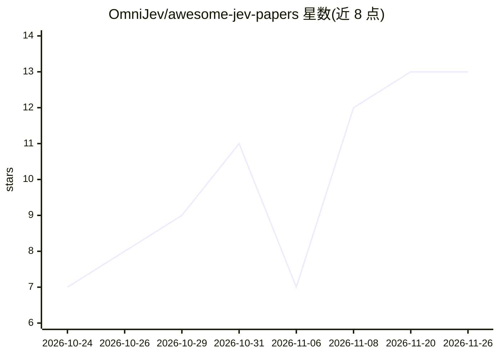

# OmniJev/awesome-jev-papers

⭐ 13 · Python · NOASSERTION · 推送 2026-11-25 · [GitHub](https://github.com/OmniJev/awesome-jev-papers) · [官网](https://omnijev.github.io/awesome-jev-papers/) · 组织维护

**围绕 Jev/System One 决策模型的论文清单（228 篇）**

一个 awesome 形式的论文聚合清单，收录 228 篇关于 Jev（TypeSafe 的 System One 决策模型）及同类开放式决策模型的研究论文，按综述、开放模型、基准评测、Judge/分类器、校准、鲁棒性、Agent、应用等类别组织。每条目附 arXiv 链接，部分附代码/模型/网站/Daily Papers 链接，README 声明每条均对照 arXiv 页面核验，并通过 PR 持续更新（含两条批量新增记录）。

## 筛选速览

| 维度 | 判定 | 备注 |
|---|---|---|
| AI 角色 | `ai-knowledge` | 知识聚合/清单类 |
| 许可风险 | `none` | NOASSERTION |
| 部署形态 | `None` |  |
| 模型依赖 | — | README 未给出锁定关系 |
| 硬件要求 | — | 无带数字的原话,不猜 |
| 安装摩擦 | `low` | 无编译、无系统依赖或容器化 |
| 成熟度 | — | 结构信号不足 |

## 能力要点

- 收录 228 篇论文，按 8 个主题类别组织
- 条目附 arXiv 链接，部分附代码与模型链接
- 声明每条目均对照 arXiv 页面核验
- 通过 pull request 持续收录新论文

## 适用场景

- 跟踪 Jev/System One 决策模型方向的研究进展
- 为相关研究查找开放模型实现与基准
- 了解校准、Judge、鲁棒性等评测文献分布

## 场景标签

`精选清单` · 领域:学习与行业

## 证据(README 行号)

> L1: Awesome JEV Papers, research on System One decision models: 228 papers
> L16: 🧭 Survey · 🔓 Open models · 📏 Benchmarks · 📊 Judges · 🎯 Calibration · 🛡️ Robustness · 🤖 Agents · 🌍 Applications
> L26: 🚀 **2026-09-28 · Launch.** 29 papers on Jev from the first two weeks after its release on 15 September. Every entry

## 星数曲线

2026-10-24 7 → 2026-11-26 13（+6）

---
*卡片 v1 · prompt 1.4 · 生成 2026-11-18 · 置信度 high · 依据 README sha `f60c311b3b74` · [字段定义](../../DATASET.md)*
