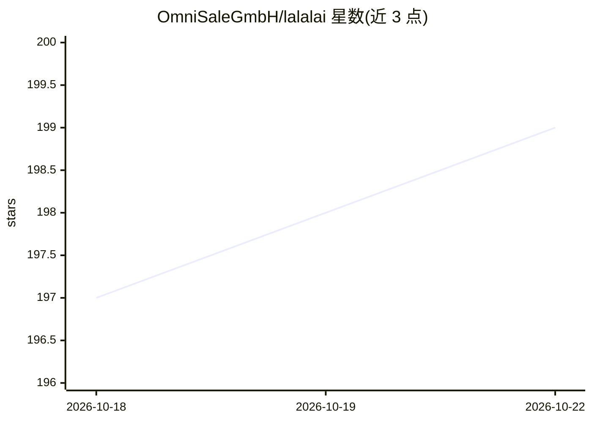

# OmniSaleGmbH/lalalai

⭐ 199 · Python · 推送 2026-09-29 · [GitHub](https://github.com/OmniSaleGmbH/lalalai) · [官网](https://www.lalal.ai/) · 组织维护

**LALAL.AI 官方 API 示例库：音轨分离与人声处理服务接入**

OmniSale GmbH 维护的 LALAL.AI API 官方 Python 示例仓库，覆盖 stem 分离（最多 10 轨：人声/伴奏/鼓/贝斯/吉他/钢琴/合成器/管乐/弦乐）、Voice Cleaner 降噪、语音克隆、Voice Changer、Lead & Back Vocal Splitter、回声混响消除等服务。API V1 为推荐版本，附 OpenAPI 规范；API V0 已弃用但保留旧示例。面向音乐人、视频博主、转录者等需要将 AI 音频处理集成到自有站点或应用的开发者与商户。

## 筛选速览

| 维度 | 判定 | 备注 |
|---|---|---|
| AI 角色 | `ai-native` | 本体是模型或模型工具 |
| 许可风险 | `none` | — |
| 部署形态 | `None` |  |
| 模型依赖 | — | README 未给出锁定关系 |
| 硬件要求 | — | 无带数字的原话,不猜 |
| 安装摩擦 | `low` | 无编译、无系统依赖或容器化 |
| 成熟度 | — | 结构信号不足 |

## 能力要点

- 最多 10 轨 stem 分离的 API 示例
- Voice Cleaner 降噪、语音克隆、Voice Changer 等 API 服务示例
- API V1 含 OpenAPI 规范与端点浏览工具
- 历届自研神经网络（Rocknet 至 Lynx）驱动各服务

## 适用场景

- 在我的音乐制作流程中通过 API 拆分人声与伴奏
- 为视频/播客内容做背景噪声与人声清理
- 在自有应用中集成语音克隆或变声功能

## 场景标签

 · 领域:音频处理/AI 服务

## 证据(README 行号)

> L3: Extract vocal, accompaniment and various instruments from any audio and video
> L30: Starting as a 2-stem splitter, LALAL.AI has grown significantly during 2021. In addition to **vocal and instrumenta
> L63: **Services:**

## 星数曲线

2026-10-18 197 → 2026-10-22 199（+2）

---
*卡片 v1 · prompt 1.4 · 生成 2026-10-22 · 置信度 high · 依据 README sha `172f18ee9878` · [字段定义](../../DATASET.md)*
