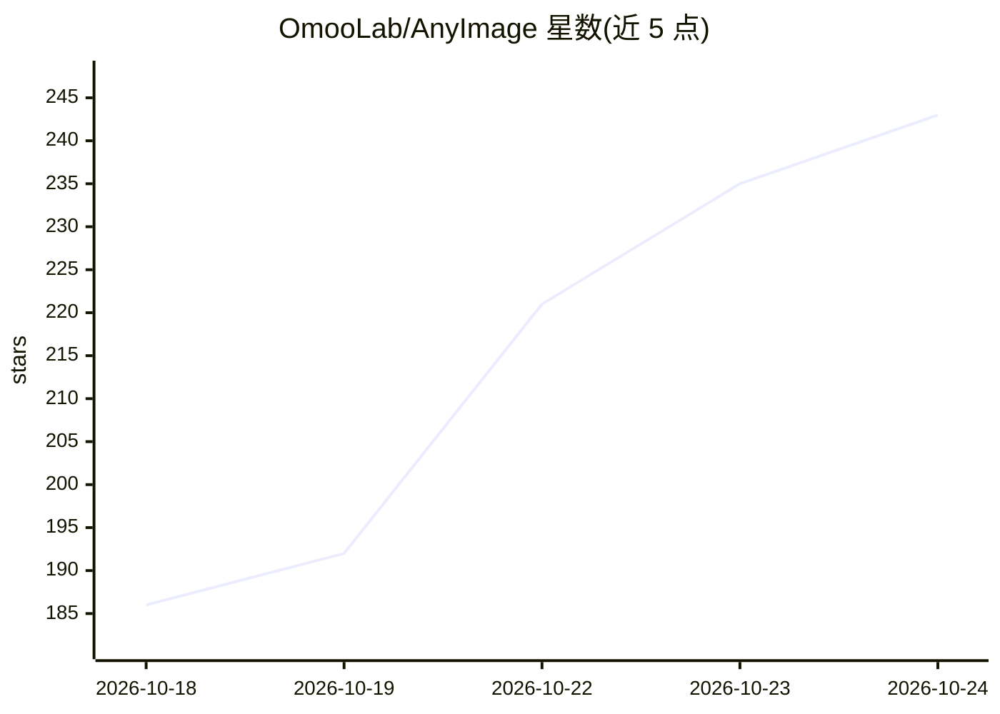

# OmooLab/AnyImage

⭐ 249 · Python · NOASSERTION · 推送 2026-10-24 · [GitHub](https://github.com/OmooLab/AnyImage) · [官网](https://docs.omoolab.xyz/anyimage/latest/) · 组织维护 · 中文 README

**Blender 图像工具包：将粘贴的图像转为场景元素**

由 OmooLab 开发的 Blender 插件，围绕图像建模提供工具链：在 3D 视图或节点编辑器中通过快捷键直接从剪贴板粘贴图像；可将图像转换为平面/深度平面，或选取主体生成 Surface、Balloon、Depth Shape 等立体形态；另含图像工具组（重新取景、透明区编辑、透视校正、抠图与放大）。面向在 Blender 中以图像为起点构建场景的用户，通过右键菜单与快捷键操作。

## 筛选速览

| 维度 | 判定 | 备注 |
|---|---|---|
| AI 角色 | `ai-enhanced` | 去掉 AI 部分产品仍成立 |
| 许可风险 | `none` | NOASSERTION |
| 部署形态 | `None` |  |
| 模型依赖 | — | README 未给出锁定关系 |
| 硬件要求 | — | 无带数字的原话,不猜 |
| 安装摩擦 | `low` | 无编译、无系统依赖或容器化 |
| 成熟度 | — | 结构信号不足 |

## 能力要点

- Ctrl+Shift+V 从剪贴板直接粘贴图像到工作区
- 图像转 Plane/Depth Plane 平面形态
- 选取主体生成 Surface/Balloon/Depth Shape
- 图像工具组：取景、透视校正、抠图、放大

## 适用场景

- 在 Blender 中以参考图快速搭建场景元素
- 把图像主体转为带轮廓与深度的立体形态
- 粘贴图像时无需先保存文件、不中断工作流

## 场景标签

`图像视频处理` · 领域:感知与多模态

## 证据(README 行号)

> L9: AnyImage is an image toolkit for Blender by OmooLab. It turns images into more than references: paste an image, sele
> L21: - **Image tools**: Reframe images, edit transparent areas, correct perspective, remove backgrounds, and upscale.

## 星数曲线

2026-10-18 186 → 2026-10-24 243（+57）

---
*卡片 v1 · prompt 1.4 · 生成 2026-10-22 · 置信度 mid · 依据 README sha `954f432a3cef` · [字段定义](../../DATASET.md)*
