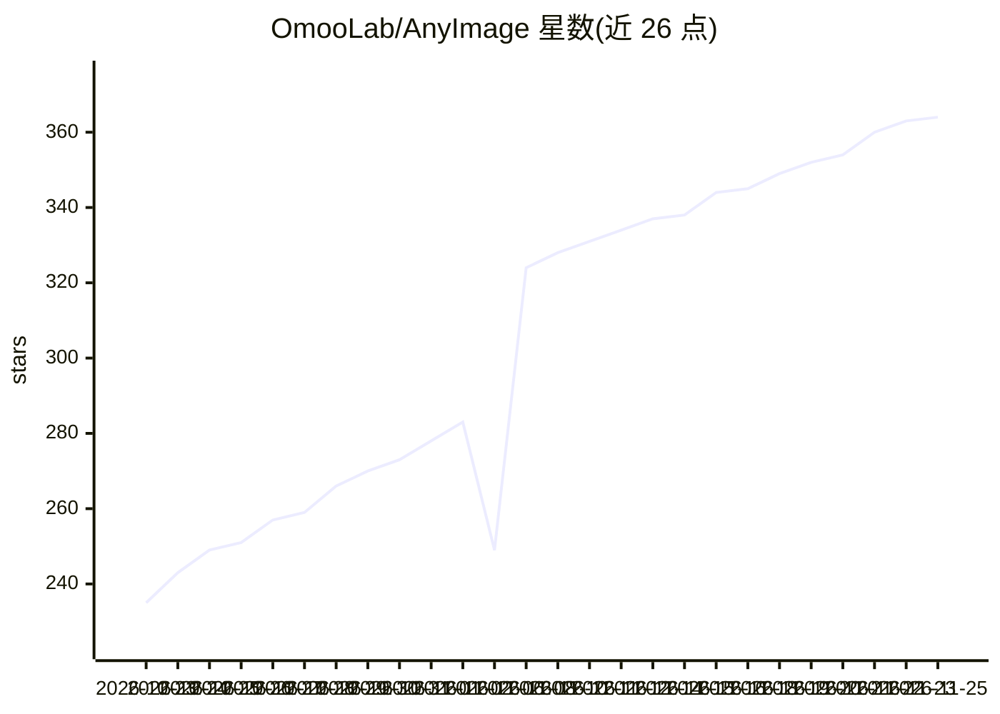

# OmooLab/AnyImage

⭐ 364 · Python · NOASSERTION · 推送 2026-11-23 · [GitHub](https://github.com/OmooLab/AnyImage) · [官网](https://docs.omoolab.xyz/anyimage/latest/) · 组织维护 · 中文 README

**Blender 插件：以图片为起点建模、贴图、组景**

一款 Blender 扩展，将图像作为创作起点：支持剪贴板快捷键粘贴图像到场景（雕刻/纹理绘制模式下转为笔刷纹理，节点编辑器中生成图像节点）、从参考图抠出 3D 形状、照片转地形/浮雕/全景场景、裁剪合成、四点校正、颜色匹配等。内置离线运行的 AI 工具，用于去除背景和 2 倍放大图像，无需按图计费。README 含安装章节。

## 筛选速览

| 维度 | 判定 | 备注 |
|---|---|---|
| AI 角色 | `ai-enhanced` | 去掉 AI 部分产品仍成立 |
| 许可风险 | `none` | NOASSERTION |
| 部署形态 | `None` |  |
| 模型依赖 | — | README 未给出锁定关系 |
| 硬件要求 | — | 无带数字的原话,不猜 |
| 安装摩擦 | `low` | 无编译、无系统依赖或容器化 |
| 成熟度 | — | 结构信号不足 |

## 能力要点

- Ctrl+Shift+V 将剪贴板图像直接粘贴进 Blender 场景或节点编辑器
- Cutout 抠图生成 3D 形体，照片可转地形、浮雕与全景场景
- 离线运行的 AI 去背景与 2× 图像放大，无按图计费

## 适用场景

- 把参考图快速抠成 3D 元素放进场景试摆
- 将照片转成深度面/地形/浮雕用于建模
- 离线批量去除贴图背景并放大纹理

## 场景标签

`图像视频处理` · 领域:感知与多模态

## 证据(README 行号)

> L5: **IMAGE IS ALL YOU NEED**. Any Image makes images a starting point for creating in Blender. Model from references, a
> L31: ## Fast AI tools that run offline!
> L33: Remove backgrounds and upscale images by 2× right on your computer, with no per-image fees. You can process image t

## 星数曲线

2026-10-23 235 → 2026-11-25 364（+129）

---
*卡片 v1 · prompt 1.4 · 生成 2026-11-25 · 置信度 high · 依据 README sha `f5a907c93cf8` · [字段定义](../../DATASET.md)*
