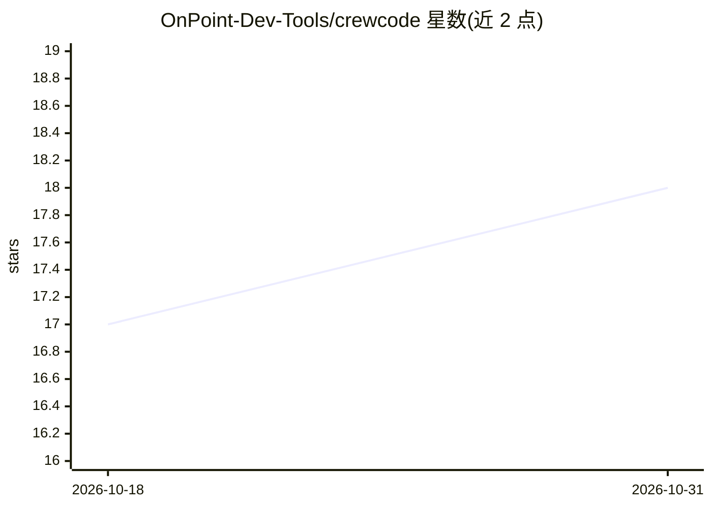

# OnPoint-Dev-Tools/crewcode

⭐ 18 · TypeScript · Apache-2.0 · 推送 2026-10-26 · [GitHub](https://github.com/OnPoint-Dev-Tools/crewcode) · [官网](https://crewcode.logixhub.icu/) · 组织维护

**多 AI 编码代理的桌面控制中心：并行运行与审查代理**

面向 repo-first 开发者的开源桌面开发环境（ACE），在一个窗口内并行运行 Claude Code、Codex、OpenCode、Ollama 等多个 AI 编码代理，每个代理在独立 git worktree 分支上工作以避免冲突。集成聊天、真实终端、代码编辑器与审查工作流（diff、合并冲突、PR），支持代理间会话切换交接、crew 并行编排、本地插件平台（mock/exec/http 代理提供者）、嵌入式浏览器取上下文、可选的实时语音层（含 NVIDIA Parakeet/Kokoro 本地方案）。支持 SSH 远程工作区、自托管 Hub 从浏览器继续工作（预览功能）。Linux 提供 AppImage/原生包安装器，目标平台含 macOS 与 Windows。

## 筛选速览

| 维度 | 判定 | 备注 |
|---|---|---|
| AI 角色 | `ai-ecosystem` | LLM/agent 周边工具 |
| 许可风险 | `permissive` | Apache-2.0 |
| 部署形态 | `None` |  |
| 模型依赖 | — | README 未给出锁定关系 |
| 硬件要求 | — | 无带数字的原话,不猜 |
| 安装摩擦 | `low` | 无编译、无系统依赖或容器化 |
| 成熟度 | `idea` | |

## 能力要点

- 单窗口并行运行多家 AI 编码代理，各自独立 git worktree
- 会话中途切换 Provider 并生成交接摘要
- 本地插件平台：自定义面板、MCP 声明、插件驱动的代理提供者（mock/exec/http）
- 实时语音层可选 GPT Realtime、xAI Voice 或全本地方案（Parakeet+Kokoro）

## 适用场景

- 我在多个真实仓库上并行跑多个编码代理并统一审查其改动
- 小团队试验受监督的多代理工作流
- 在外面用浏览器或手机接续家里机器上的代理会话

## 场景标签

`编码 Agent` `多智能体` · 领域:Agent 开发

## 证据(README 行号)

> L20: CrewCode is a free, open-source desktop ACE for developers who already work repo-first and agent-first.
> L24: CrewCode is a desktop development environment that runs multiple AI coding agents in parallel within a single windo
> L46: - Run **CrewCoder agent**, **Claude Code agent**, **Codex**, **OpenCode**, **pi**, **Ollama**, **Hermes**, **OpenRo

## 星数曲线

2026-10-18 17 → 2026-10-31 18（+1）

---
*卡片 v1 · prompt 1.4 · 生成 2026-10-30 · 置信度 high · 依据 README sha `d01e08a0077a` · [字段定义](../../DATASET.md)*
