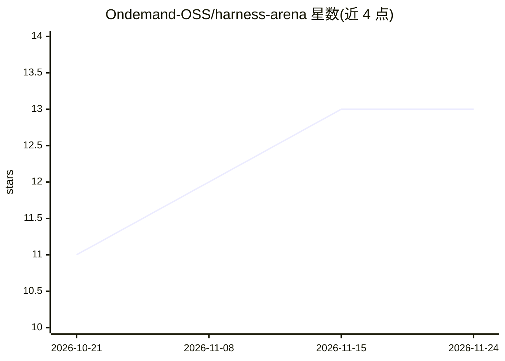

# Ondemand-OSS/harness-arena

⭐ 13 · Python · MIT · 推送 2026-10-19 · [GitHub](https://github.com/Ondemand-OSS/harness-arena) · [官网](https://harness-arena.ai) · 组织维护

**对 coding agent harness 做盲测对比的竞技场平台**

以 LMSYS Chatbot Arena 的方式评测 agent harness 而非模型：同一任务在同一模型与 provider 配置下交由多个 harness（Claude Code、Codex CLI、OpenClaw、Hermes 等）在隔离工作区独立运行，采集产出文件后由人类盲评，提交评分后才揭示身份，结果汇总为每次从完整评分历史重算的 Elo 排行榜。本仓库为 FastAPI + MongoDB 后端，前端独立部署；任务从 Excel 导入，支持本地 CLI 与 webhook 两种扩展方式。

## 筛选速览

| 维度 | 判定 | 备注 |
|---|---|---|
| AI 角色 | `ai-ecosystem` | LLM/agent 周边工具 |
| 许可风险 | `permissive` | MIT |
| 部署形态 | `self-host` | docker 或自建部署 |
| 模型依赖 | — | README 未给出锁定关系 |
| 硬件要求 | — | 无带数字的原话,不猜 |
| 安装摩擦 | `low` | 无编译、无系统依赖或容器化 |
| 成熟度 | `idea` | |

## 能力要点

- 同任务、同模型、隔离工作区运行多个 harness
- 盲评机制：评分前匿名展示，提交后揭示身份
- Elo 排行榜从完整评分历史重算而非增量修补
- 通过 HarnessAdapter 接口或 webhook 接入自定义 harness

## 适用场景

- 为团队的 coding agent 工具选型组织盲测对比
- 搭建公开的 harness 评测排行榜
- 导入自有任务集，按统一 rubric 评测不同 harness

## 场景标签

`模型评测` · 领域:评测与运维

## 证据(README 行号)

> L14: Agentic Harness Arena runs the same task through multiple agent harnesses — Claude Code, Codex CLI, and more — hold
> L56: backend/    (this repo) FastAPI + MongoDB. Dataset import, run orchestration,

## 星数曲线

2026-10-21 11 → 2026-11-24 13（+2）

---
*卡片 v1 · prompt 1.4 · 生成 2026-11-18 · 置信度 mid · 依据 README sha `788f6ae321dd` · [字段定义](../../DATASET.md)*
