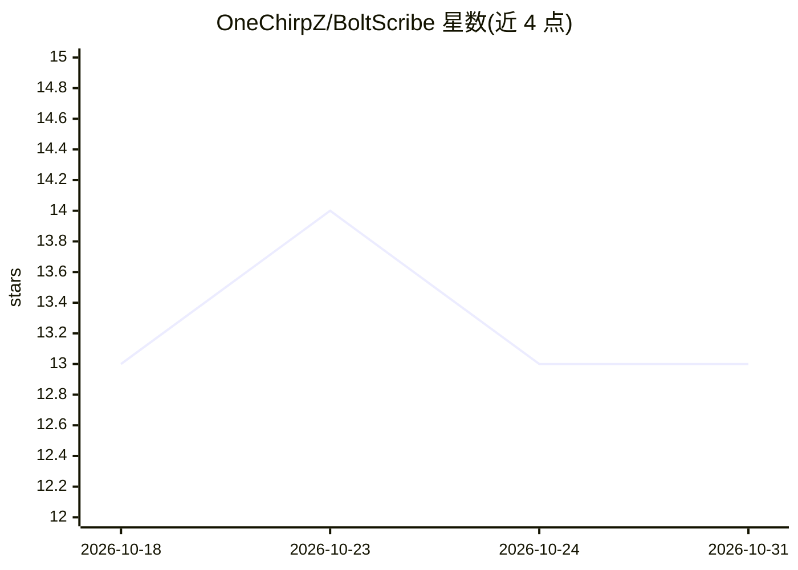

# OneChirpZ/BoltScribe

⭐ 13 · Rust · NOASSERTION · 推送 2026-09-11 · [GitHub](https://github.com/OneChirpZ/BoltScribe) · 个人维护 · 中文 README

**macOS/Windows 桌面听写应用：全局热键语音转文字**

常驻菜单栏/系统托盘的双语听写应用：按全局热键开始/结束录音，语音经 Volcengine ASR 实时转录，可选接入 OpenAI 兼容模型做文本清理（标点、措辞、术语，支持个人词典、纠正规则与多模型竞速），结果自动粘贴到当前应用。提供本地历史、输入统计、重试、无语音保护（Beta）、录音反馈与本地数据留存控制。需自备 ASR 凭证；启用清理需模型 API key。macOS 包为 ad-hoc 签名未公证。

## 筛选速览

| 维度 | 判定 | 备注 |
|---|---|---|
| AI 角色 | `ai-native` | 本体是模型或模型工具 |
| 许可风险 | `none` | NOASSERTION |
| 部署形态 | `desktop` | 安装包/桌面程序 |
| 模型依赖 | — | README 未给出锁定关系 |
| 硬件要求 | — | 无带数字的原话,不猜 |
| 安装摩擦 | `low` | 无编译、无系统依赖或容器化 |
| 成熟度 | `idea` | |

## 能力要点

- 全局热键随处听写并自动粘贴到当前应用
- 实时转录，服务中断时自动恢复并有录音回退
- 可选 OpenAI 兼容模型文本清理，支持词典、纠正规则与多模型竞速
- 历史、录音与输入统计本地留存，可设保留期限

## 适用场景

- 在任意桌面应用中用语音快速输入文字
- 口述后自动润色标点与术语再粘贴
- 回看转录历史、统计输入量并重试失败项

## 场景标签

`语音识别` · 领域:感知与多模态

## 证据(README 行号)

> L19: BoltScribe turns speech into ready-to-use text from anywhere on your desktop. Press a global hotkey to begin, press
> L36: - **Real-time transcription:** see a continuous listening state, with automatic recovery and recorded-audio fallbac

## 星数曲线

2026-10-18 13 → 2026-10-31 13（+0）

---
*卡片 v1 · prompt 1.4 · 生成 2026-10-31 · 置信度 high · 依据 README sha `24d55e7d9be3` · [字段定义](../../DATASET.md)*
