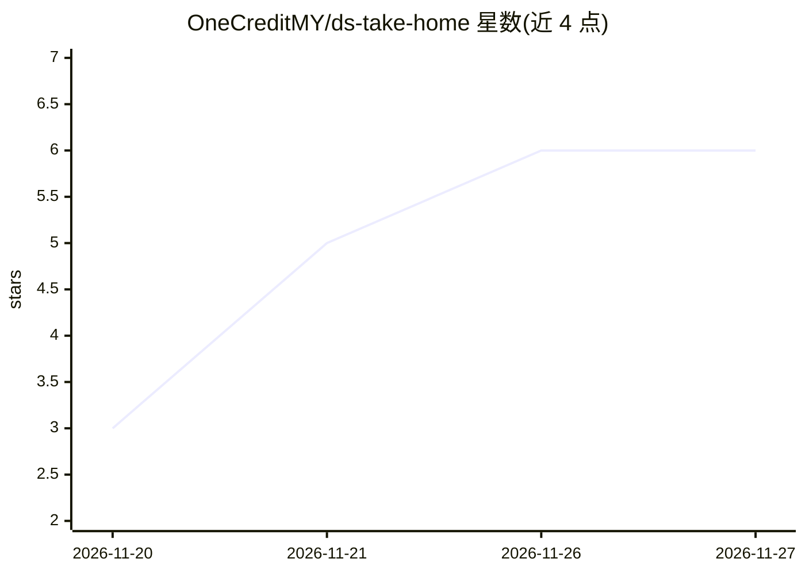

# OneCreditMY/ds-take-home

⭐ 6 · HTML · 推送 2026-11-19 · [GitHub](https://github.com/OneCreditMY/ds-take-home) · 组织维护

**面向初级数据科学家的 LLM 招聘带回家测评题**

OneCredit 发布的数据科学岗位带回家测评模板：候选人生成一个为 50 家公司写简短摘要的系统（可调用免费 LLM API），并提交公开仓库、jsonl 格式摘要和 CASE_STUDY.md 案例研究，评估预算 6-8 小时。仓库附带合成公司数据、本地 Web 查看器（FastAPI + Docker，仅读文件不调用模型）、just 任务脚本与评分标准。非应聘者也可自行练习。

## 筛选速览

| 维度 | 判定 | 备注 |
|---|---|---|
| AI 角色 | `ai-knowledge` | 知识聚合/清单类 |
| 许可风险 | `none` | — |
| 部署形态 | `library` | 以包/库形式分发 |
| 模型依赖 | — | README 未给出锁定关系 |
| 硬件要求 | — | 无带数字的原话,不猜 |
| 安装摩擦 | `low` | 无编译、无系统依赖或容器化 |
| 成熟度 | — | 结构信号不足 |

## 能力要点

- 提供 50 家合成公司记录（含工商、财务、诉讼字段）的 jsonl 数据
- 内置本地查看器：并排对比多个版本的摘要（FastAPI + Docker）
- 公开评分标准：摘要质量判断、系统评估方式、表达清晰度
- 允许使用任何免费 LLM API，也接受付费 key，不影响评分

## 适用场景

- 应聘初级数据科学家岗位完成带回家测评
- 练习 LLM 应用搭建与评估流程
- 企业参考其结构设计类似的技术测评题

## 场景标签

 · 领域:招聘/教育测评

## 证据(README 行号)

> L1: # DS Take-Home: Company Summaries
> L3: **tl;dr:** Build a system that writes a short summary of a company, then write a case study on how you built it and 
> L5: **Who it's for:** early-career data scientists with 0 to 2 years of experience. Fresh graduates are very welcome.

## 星数曲线

2026-11-20 3 → 2026-11-27 6（+3）

---
*卡片 v1 · prompt 1.4 · 生成 2026-11-21 · 置信度 mid · 依据 README sha `bb051e3b8472` · [字段定义](../../DATASET.md)*
