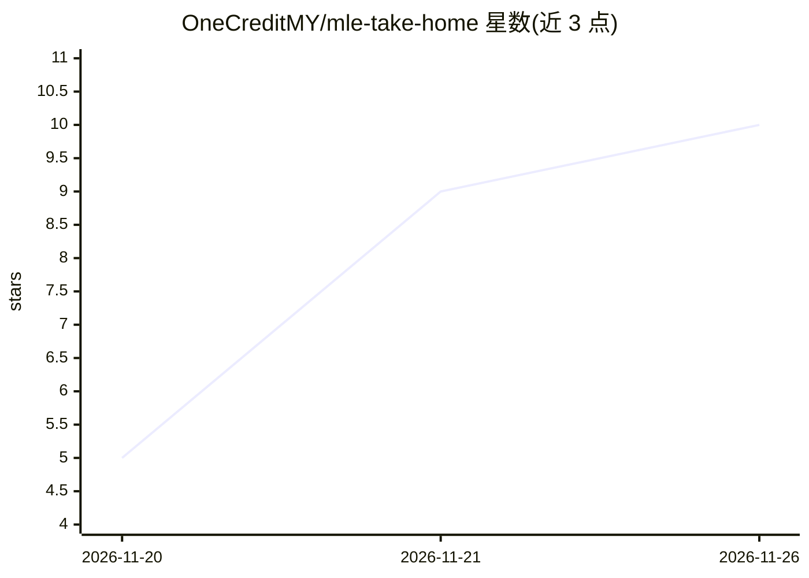

# OneCreditMY/mle-take-home

⭐ 10 · Python · 推送 2026-11-17 · [GitHub](https://github.com/OneCreditMY/mle-take-home) · 组织维护

**OneCredit 面向 0-2 年经验 MLE 的招聘带回家测评**

OneCredit Data & AI 团队发布的机器学习工程师带回家招聘测评（2026.11 版）：候选人在 4-6 小时内构建一个相似公司推荐服务——消费 RabbitMQ 公司事件流、用 Postgres+pgvector 存储业务描述向量并做相似度检索，另写 DESIGN.md 说明设计决策。仓库自带合成数据（2,518 条消息、2,000 家马来西亚合成公司）、消息生产者与 docker-compose 环境，用 just 管理命令。要求嵌入模型在笔记本 CPU 上运行、禁止付费 API；允许使用 AI 工具但需申报。

## 筛选速览

| 维度 | 判定 | 备注 |
|---|---|---|
| AI 角色 | `ai-knowledge` | 知识聚合/清单类 |
| 许可风险 | `none` | — |
| 部署形态 | `library` | 以包/库形式分发 |
| 模型依赖 | — | README 未给出锁定关系 |
| 硬件要求 | — | 无带数字的原话,不猜 |
| 安装摩擦 | `low` | 无编译、无系统依赖或容器化 |
| 成熟度 | — | 结构信号不足 |

## 能力要点

- 完整测评场景：RabbitMQ 事件消费 + pgvector 向量检索 + API 服务
- 内置合成数据集与消息回放生产者（producer/publish.py）
- just 命令一键启动 Postgres(pgvector) 与 RabbitMQ 环境
- 要求开源 CPU 嵌入模型（如 BAAI/bge-small-en-v1.5），禁用付费 API

## 适用场景

- 作为 MLE 岗位候选人的带回家作业
- 练习 RabbitMQ 消费与 pgvector 相似度检索
- 作为可公开的作品集项目积累实战经验

## 场景标签

 · 领域:招聘/机器学习教育

## 证据(README 行号)

> L3: Welcome to the **Machine Learning Engineer** take-home from the OneCredit Data & AI team. It's a simplified version 
> L6: **Who it's for:** people early in their career, with 0 to 2 years of experience. Fresh graduates are welcome.
> L11: Assessment version: **2026.11** (`mle-v2026.11`). What changed between versions is in `CHANGELOG.md`.

## 星数曲线

2026-11-20 5 → 2026-11-26 10（+5）

---
*卡片 v1 · prompt 1.4 · 生成 2026-11-21 · 置信度 mid · 依据 README sha `71ee2e3d3bce` · [字段定义](../../DATASET.md)*
