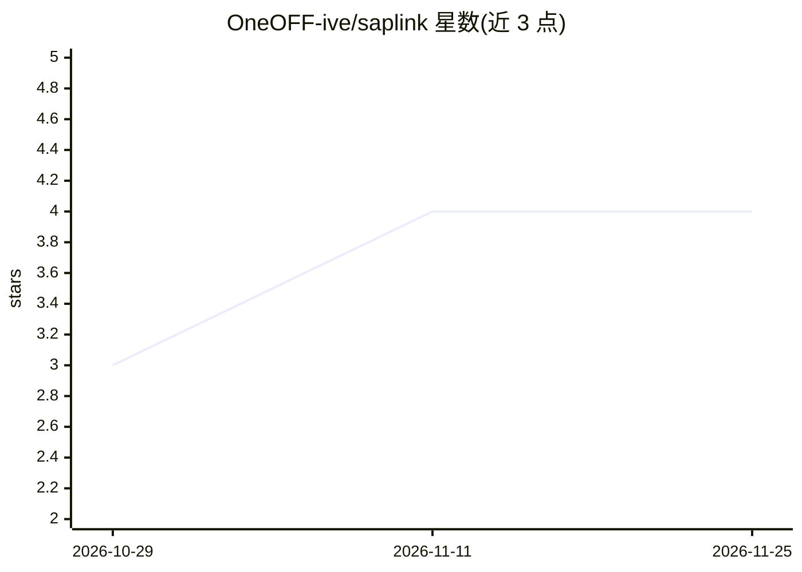

# OneOFF-ive/saplink

⭐ 4 · TypeScript · 推送 2026-11-11 · [GitHub](https://github.com/OneOFF-ive/saplink) · [官网](https://saplink.cloud) · 个人维护 · 中文 README

**面向 AI Agent 的本地 SAP ABAP 连接工具（CLI/MCP）**

独立运行的 Windows 应用，通过 ADT（HTTP 或 RFC/JCo）连接 SAP 系统，将源码搜索、开发对象读取、程序创建修改、语法检查、激活和数据查询封装为 CLI 工具，供支持本机命令的 AI 客户端调用；MCP 为可选接入方式。内置管理界面管理多连接与令牌，连接默认关闭写入，通过 SAP 权限、对象锁与版本检查约束修改。安装包自带 Java 和 JCo，不依赖 VS Code 或 SAP GUI。定位为开发与查询工具，不提供调试、任意 ABAP 执行或对象删除。

## 筛选速览

| 维度 | 判定 | 备注 |
|---|---|---|
| AI 角色 | `ai-ecosystem` | LLM/agent 周边工具 |
| 许可风险 | `none` | — |
| 部署形态 | `desktop` | 安装包/桌面程序 |
| 模型依赖 | — | README 未给出锁定关系 |
| 硬件要求 | — | 无带数字的原话,不猜 |
| 安装摩擦 | `low` | 无编译、无系统依赖或容器化 |
| 成熟度 | — | 结构信号不足 |

## 能力要点

- CLI 为默认接入方式，无需配置 MCP 或创建访问令牌
- 支持 HTTP/HTTPS 与 RFC/JCo 双通道连接 SAP，可复用 ADT 写入保护
- 连接默认关闭写入，密码保存在 Windows 凭据管理器
- 安装包内置 Java 与 JCo 运行环境，无需另装 Node.js

## 适用场景

- 让 AI agent 搜索并解释现有 ABAP 程序逻辑
- 通过 agent 在指定测试包中创建或修改 ABAP 程序并完成语法检查与激活
- 用自然语言查询 SAP 表与 CDS 实体数据并汇总
- 查找客户出口、BAdI 等增强点辅助开发

## 场景标签

`编码 Agent` `数据分析` · 领域:效率与自动化

## 证据(README 行号)

> L7:  面向 AI Agent 的本地 SAP ABAP 连接应用
> L16: SapLink 将 SAP 中的源码、开发对象和数据查询能力，默认通过 CLI 提供给支持本机命令的 AI 客户端，配合 SapLink 技能即可使用。MCP 保留为供愿意研究接入方式的用户自行配置的额外功能。你可以在熟悉的 AI
> L44: AI 客户端 + SapLink 技能 → SapLink CLI → SAP ADT（HTTP 或 RFC）→ SAP ABAP 系统

## 星数曲线

2026-10-29 3 → 2026-11-25 4（+1）

---
*卡片 v1 · prompt 1.4 · 生成 2026-11-21 · 置信度 high · 依据 README sha `b5f3b0de0fb8` · [字段定义](../../DATASET.md)*
