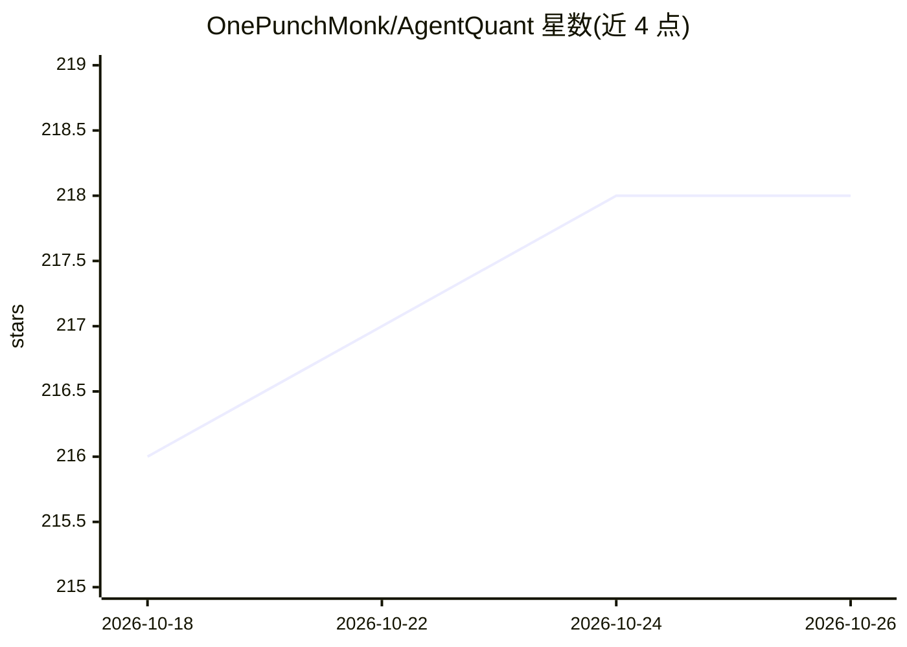

# OnePunchMonk/AgentQuant

⭐ 218 · Python · MIT · 推送 2026-10-23 · [GitHub](https://github.com/OnePunchMonk/AgentQuant) · 个人维护

**自进化量化策略研究 harness：带失败记忆的 agent 搜索回测框架**

面向量化研究者的策略搜索 agent 框架：以 ReAct 循环（分析→假设→回测→反思→存储→改进）迭代提出并检验交易策略，跨会话 SQLite 记忆保存已测策略与失败经验，walk-forward 留出集单独评估泛化风险。核心循环离线可用（确定性合成数据、网格/随机回退路径，无需 API key），接入 ANTHROPIC/TAVILY key 后启用 LLM 引导提案与网络检索。部分能力（GA/DE 优化器、multi-agent 集成、grid 自适应）标注为实验性或未接线，运行时对未实现配置显式抛错而非静默忽略。可导出执行轨迹至 harnesskit 做离线重放评估，并集成 Peek 做时间序列泄漏审计。

## 筛选速览

| 维度 | 判定 | 备注 |
|---|---|---|
| AI 角色 | `ai-native` | 本体是模型或模型工具 |
| 许可风险 | `permissive` | MIT |
| 部署形态 | `self-host` | docker 或自建部署 |
| 模型依赖 | locked-api |  |
| 硬件要求 | — | 无带数字的原话,不猜 |
| 安装摩擦 | `low` | 无编译、无系统依赖或容器化 |
| 成熟度 | `idea` | |

## 能力要点

- ReAct 循环驱动的策略搜索，跨会话 SQLite 记忆保留实验与失败经验
- 零 key 本地 demo：确定性合成数据，JSON 报告与净值曲线产物
- 三级证据分层（fixture/实测历史/未验证遗留），CI 重跑校验 checked-in 结果一致性
- harnesskit 轨迹导出重放 + Peek 泄漏审计作为基准解读前置条件

## 适用场景

- 离线验证策略搜索回路的安装与接线是否正确
- 研究者以留出集 Sharpe 差距跟踪策略过拟合风险
- 跨多次实验积累策略记忆并复盘哪些假设失败
- 导出 agent 轨迹到统一评估层做 harness 回归对比

## 场景标签

`金融量化` `Agent 框架` `Agent 记忆` · 领域:Agent 开发

## 证据(README 行号)

> L105: - ✅ **Runs a real ReAct loop** — analyze → hypothesize → backtest → reflect → store → improve
> L106: - ✅ **Remembers across runs** — Cross-session SQLite memory lets the agent learn what worked

## 星数曲线

2026-10-18 216 → 2026-10-26 218（+2）

---
*卡片 v1 · prompt 1.4 · 生成 2026-10-22 · 置信度 high · 依据 README sha `b8f72f76c305` · [字段定义](../../DATASET.md)*
