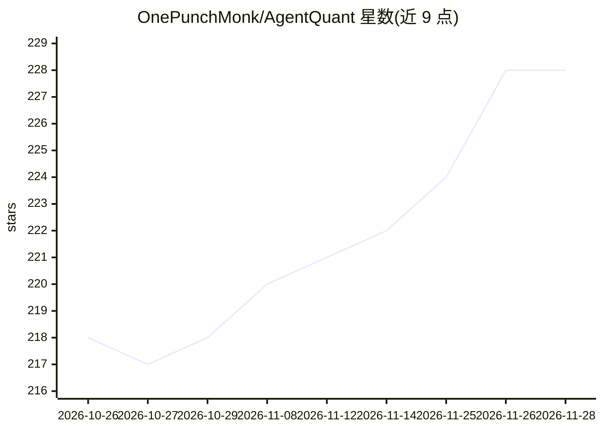

# OnePunchMonk/AgentQuant

⭐ 228 · Python · MIT · 推送 2026-11-27 · [GitHub](https://github.com/OnePunchMonk/AgentQuant) · 个人维护

**量化研究 agent 的实验框架：记录失败证据并按门控选择实验**

AgentQuant 是面向研究 agent 的实验 harness：生成候选策略、回测、记录带出处的试验与笔记，并支持按市场时间截点查询记忆；提供 frozen/random/grid/memory/mutation 等搜索基线与时间切分的对比，以及运行清单、轨迹、研究备忘等导出与回放。量化策略是其首个测试场景，README 明确说明验证过的自主自我改进仍是未决问题，示例为合成数据且非交易业绩基准。Python 3.10+，离线演示无需 API key。

## 筛选速览

| 维度 | 判定 | 备注 |
|---|---|---|
| AI 角色 | `ai-ecosystem` | LLM/agent 周边工具 |
| 许可风险 | `permissive` | MIT |
| 部署形态 | `library` | 以包/库形式分发 |
| 模型依赖 | — | README 未给出锁定关系 |
| 硬件要求 | — | 无带数字的原话,不猜 |
| 安装摩擦 | `low` | 无编译、无系统依赖或容器化 |
| 成熟度 | — | 结构信号不足 |

## 能力要点

- 带失败记录的试验台账与搜索感知对比工具（gate 包）
- 点时证据存储：按市场时间截点查询记忆
- 五种搜索基线（frozen/random/grid/memory/mutation）对比
- 运行清单、轨迹与 episode bundle 导出回放

## 适用场景

- 研究 agent 提出实验、回测并从记录的证据中改进
- 对比不同实验选择策略是否优于随机搜索
- 在合成数据上离线复现量化策略研究流程

## 场景标签

`金融量化` `Agent 记忆` · 领域:Agent 开发

## 证据(README 行号)

> L7: AgentQuant is a research harness for agents that propose experiments, test them, and use recorded evidence to choose
> L13: - **Run bounded research loops.** Generate candidate strategies, backtest them, inspect failures, and evaluate the 
> L17: - **Study promotion safeguards.** The gate package provides a trial ledger and search-aware comparison tools; their

## 星数曲线

2026-10-26 218 → 2026-11-28 228（+10）

---
*卡片 v1 · prompt 1.4 · 生成 2026-11-28 · 置信度 high · 依据 README sha `2f92b59d98ec` · [字段定义](../../DATASET.md)*
