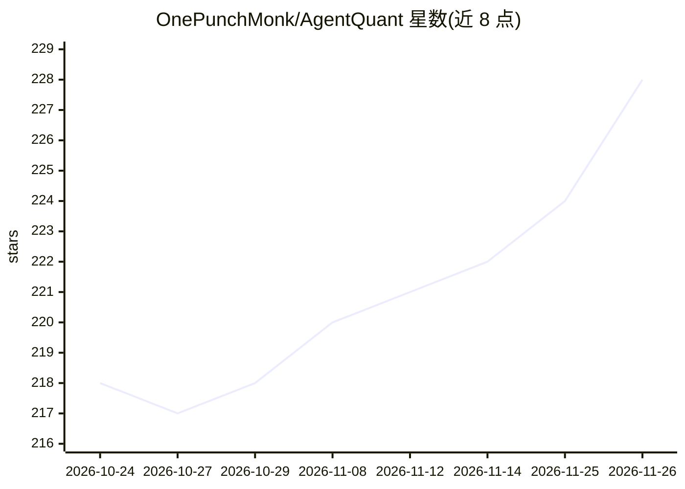

# OnePunchMonk/AgentQuant

⭐ 228 · Python · MIT · 推送 2026-11-25 · [GitHub](https://github.com/OnePunchMonk/AgentQuant) · 个人维护

**量化研究 agent 的可复现实验评估框架：追踪失败并验证改进**

AgentQuant 为研究型 agent 提供一个实验循环测试框架：提出实验、回测评估、检视结果、据此选择下一步，全程记录成功与失败尝试，支持在同一预算下对比不同搜索策略并回放其决策过程。以量化策略作为首个测试场景，核心问题是验证 agent 是否真的学会更好地选择实验。默认演示不需 API key，使用合成价格数据；LLM 引导提案与 Web 研究需另装 [llm] 扩展。作者声明自主自我改进仍属研究目标，尚未验证。

## 筛选速览

| 维度 | 判定 | 备注 |
|---|---|---|
| AI 角色 | `ai-ecosystem` | LLM/agent 周边工具 |
| 许可风险 | `permissive` | MIT |
| 部署形态 | `library` | 以包/库形式分发 |
| 模型依赖 | — | README 未给出锁定关系 |
| 硬件要求 | — | 无带数字的原话,不猜 |
| 安装摩擦 | `low` | 无编译、无系统依赖或容器化 |
| 成熟度 | — | 结构信号不足 |

## 能力要点

- 有界实验：共享回测评估器与成本模型，显式搜索预算
- 带溯源的记忆：试验、笔记与时序图证据保留来源与日期截止
- 同一 episode 上对比搜索策略，可导出 trace、episode 包与研究备忘
- 离线 prompt 变异臂不调用 LLM，演示可无 key 运行

## 适用场景

- 研究 research-agent 的行为是否随证据积累而改进
- 对比不同的记忆与提案策略在同一预算下的表现
- 基于可检视的实验循环做二次开发

## 场景标签

`模型评测` `金融量化` · 领域:评测与运维

## 证据(README 行号)

> L5: AgentQuant runs a research loop: propose an experiment, test it, inspect the result, and use that evidence to choose
> L14: - **Tools around one research loop.** Memory retrieval, hypothesis evidence, and candidate suggestions help the age
> L16: Use it to study research-agent behavior, test memory and proposal policies, or build on an inspectable experiment l

## 星数曲线

2026-10-24 218 → 2026-11-26 228（+10）

---
*卡片 v1 · prompt 1.4 · 生成 2026-11-25 · 置信度 mid · 依据 README sha `e6e588292887` · [字段定义](../../DATASET.md)*
