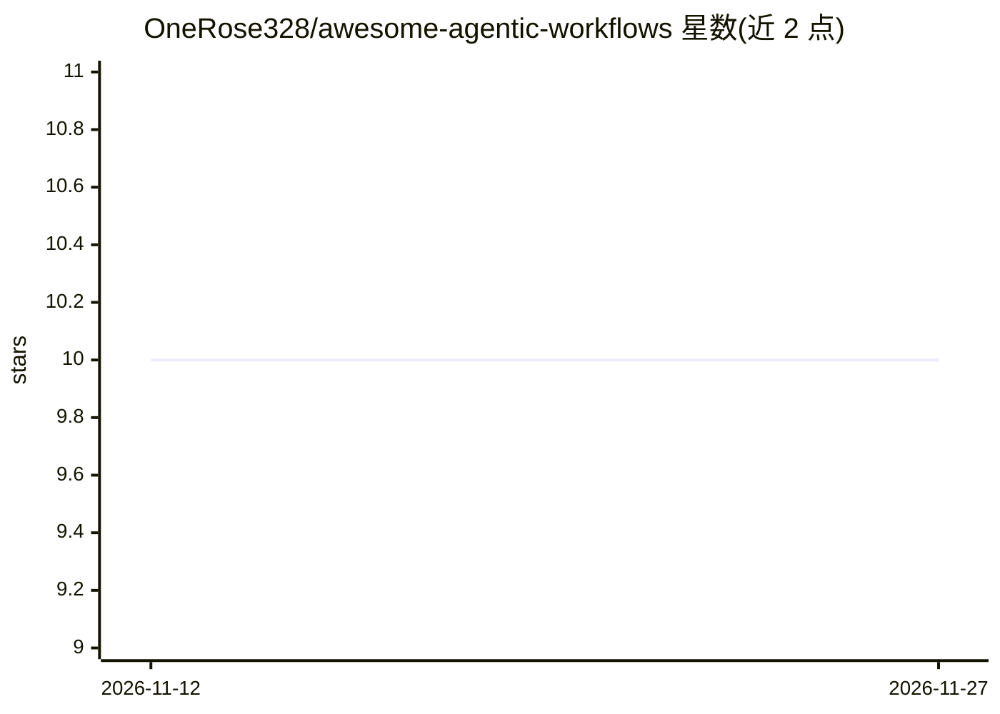

# OneRose328/awesome-agentic-workflows

⭐ 10 · MIT · 推送 2026-03-05 · [GitHub](https://github.com/OneRose328/awesome-agentic-workflows) · 个人维护 · 中文 README

**GitHub 仓库维护者的 56 个 Agentic Workflow 模板库**

收录 56 个 GitHub Agentic Workflow 模板，按 issue 管理、PR 自动化、发布、代码质量、社区、安全、开发体验 7 类组织。每个模板聚焦单一维护目标，使用读取权限加 safe-outputs 的默认安全设置，需通过 gh aw CLI 将 Markdown 编译为可运行工作流。该功能处于 technical preview，仓库声明与 2026 年 3 月 1 日官方文档对齐，建议生产启用前复核官方文档并先从低风险工作流验证。

## 筛选速览

| 维度 | 判定 | 备注 |
|---|---|---|
| AI 角色 | `ai-knowledge` | 知识聚合/清单类 |
| 许可风险 | `permissive` | MIT |
| 部署形态 | `None` |  |
| 模型依赖 | — | README 未给出锁定关系 |
| 硬件要求 | — | 无带数字的原话,不猜 |
| 安装摩擦 | `low` | 无编译、无系统依赖或容器化 |
| 成熟度 | `idea` | |

## 能力要点

- 56 个模板覆盖 issue 分诊、PR 审查、发布说明、密钥泄露检测等 7 类场景
- 模板默认读取权限 + safe-outputs，写操作显式且受限
- Markdown 源文件经 gh aw compile 生成 .lock.yml，两文件需一起提交
- 提供按处境选择入门模板的对照表与渐进启用建议

## 适用场景

- 为积压的 issue 自动打标、分诊并给出优先级
- 在 PR 合并前生成初审摘要与风险提示
- 自动起草 release notes 与升级迁移指南
- 检测提交中的密钥泄露并汇总漏洞依赖

## 场景标签

`工作流自动化` `精选清单` · 领域:效率与自动化

## 证据(README 行号)

> L13: 56 ready-to-use GitHub Agentic Workflow templates — copy one, adapt three lines, and your repository handles issue 
> L15: > **Requires:** GitHub Agentic Workflows (currently in technical preview). These are not standard GitHub Actions YA
> L91: Because this repository is a library. `templates/` is the catalog of reusable source templates. In your own reposit

## 星数曲线

2026-11-12 10 → 2026-11-27 10（+0）

---
*卡片 v1 · prompt 1.4 · 生成 2026-11-20 · 置信度 high · 依据 README sha `92f10e23cf9a` · [字段定义](../../DATASET.md)*
