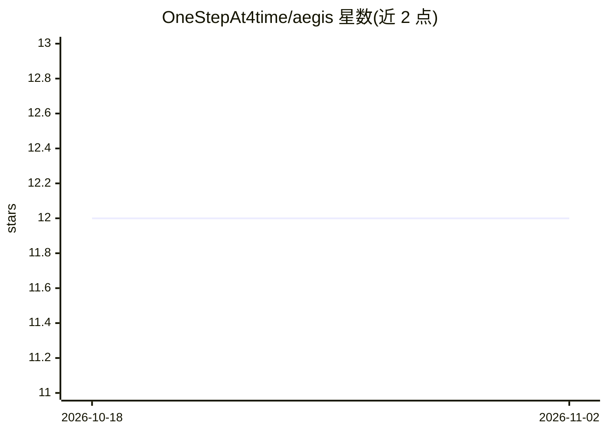

# OneStepAt4time/aegis

⭐ 12 · TypeScript · MIT · 推送 2026-10-31 · [GitHub](https://github.com/OneStepAt4time/aegis) · 个人维护

**通过 API 编排 Claude Code 会话的中间层服务器**

面向开发者的 Claude Code 会话编排工具：以子进程方式启动 claude-agent-acp 并经 JSON-RPC/stdio 通信，将 ACP 事件规范化后通过统一 REST API、SSE、MCP（34 个工具）与 Telegram/Slack/Webhook 等通道分发；提供会话创建、审批、复用、管线、记忆与模板管理，附内置 Web 仪表盘。支持 BYO LLM、多会话并行与 OpenClaw 等编排器接入。处于 Preview 阶段，API 可能变动；需 Node.js ≥ 20 与已认证的 Claude Code CLI。

## 筛选速览

| 维度 | 判定 | 备注 |
|---|---|---|
| AI 角色 | `ai-ecosystem` | LLM/agent 周边工具 |
| 许可风险 | `permissive` | MIT |
| 部署形态 | `library` | 以包/库形式分发 |
| 模型依赖 | locked-api |  |
| 硬件要求 | — | 无带数字的原话,不猜 |
| 安装摩擦 | `low` | 无编译、无系统依赖或容器化 |
| 成熟度 | `idea` | |

## 能力要点

- 经 ACP 协议桥接 Claude Code，暴露统一 REST API 与 34 个工具的 MCP 服务器
- 事件分发到 Telegram/Slack/Email/Webhook/SSE，支持手机端审批
- 内置 Web 仪表盘：会话监控、成本分析、审计记录
- 会话复用、能力协商握手、cursor 式转录回放

## 适用场景

- 在后台运行 Claude Code 任务并通过手机 Telegram 审批
- 让 AI 编排器经 API 委派并监控多个编码 agent
- 团队在 CI/CD 中做策略化权限控制与批量 PR 审查

## 场景标签

`编码 Agent` `多智能体` · 领域:Agent 开发

## 证据(README 行号)

> L99: Aegis bridges Claude Code sessions through the Agent Client Protocol (ACP) and exposes everything through a unified
> L101: 1. Spawns `claude-agent-acp` as a child process → communicates via JSON-RPC on stdio
> L117: Connect any MCP-compatible agent to Claude Code — the fastest way to build multi-agent workflows.

## 星数曲线

2026-10-18 12 → 2026-11-02 12（+0）

---
*卡片 v1 · prompt 1.4 · 生成 2026-11-01 · 置信度 mid · 依据 README sha `94d45faf653a` · [字段定义](../../DATASET.md)*
