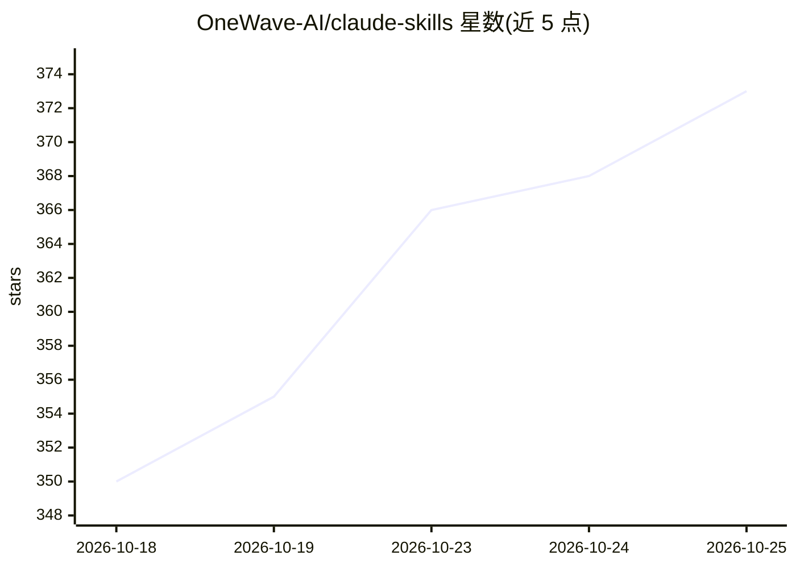

# OneWave-AI/claude-skills

⭐ 373 · Python · MIT · 推送 2026-10-20 · [GitHub](https://github.com/OneWave-AI/claude-skills) · [官网](https://www.onewave-ai.com) · 组织维护

**230 个面向 Claude Code 的生产级 agent 技能库，覆盖商业/生活/编程**

由 OneWave AI 维护的 Claude Code 技能集合：230 个单文件、零依赖的 SKILL.md 技能，按商业（销售、营销、咨询、运营）、日常生活（个人财务、旅行、求职）与编程（工程、设计、AI agent 架构）三大支柱组织。技能遵循 Agent Skills 开放标准，同一文件可在 Claude Code、OpenAI Codex CLI、Gemini CLI、Cursor 等 30+ 工具中使用，通过 claude skill install 命令安装；超过单文件规模的制品放在伴生仓库 Open Agent Stack。

## 筛选速览

| 维度 | 判定 | 备注 |
|---|---|---|
| AI 角色 | `ai-knowledge` | 知识聚合/清单类 |
| 许可风险 | `permissive` | MIT |
| 部署形态 | `None` |  |
| 模型依赖 | — | README 未给出锁定关系 |
| 硬件要求 | — | 无带数字的原话,不猜 |
| 安装摩擦 | `low` | 无编译、无系统依赖或容器化 |
| 成熟度 | — | 结构信号不足 |

## 能力要点

- 230 个单文件、零依赖、无构建步骤的 SKILL.md 技能
- 遵循 Agent Skills 开放标准，兼容 Claude Code / Codex CLI / Gemini CLI / Cursor 等 30+ 工具
- agent-army 技能支持 3-50+ 个并行 agent 的分层编排
- 覆盖销售、咨询、DevOps、设计系统等多领域工作流

## 适用场景

- 为 Claude Code 等 agent 工具按需安装销售、营销、工程类技能
- 查找 agent 编排、上下文工程类技能以增强编码代理
- 用 cowork 系列技能自动化收件箱分诊、简历筛选等办公流程

## 场景标签

`提示工程` · 领域:Agent 开发

## 证据(README 行号)

> L5: **230 skills** across three pillars: **business** (sales, marketing, consulting, ops), **everyday life** (personal f
> L26: Each skill is a self-contained `SKILL.md` file. No dependencies, no build step.
> L28: These skills follow the Agent Skills open standard, so the same files work unchanged in **Claude Code, OpenAI Codex

## 星数曲线

2026-10-18 350 → 2026-10-25 373（+23）

---
*卡片 v1 · prompt 1.4 · 生成 2026-10-22 · 置信度 high · 依据 README sha `025ac0931935` · [字段定义](../../DATASET.md)*
