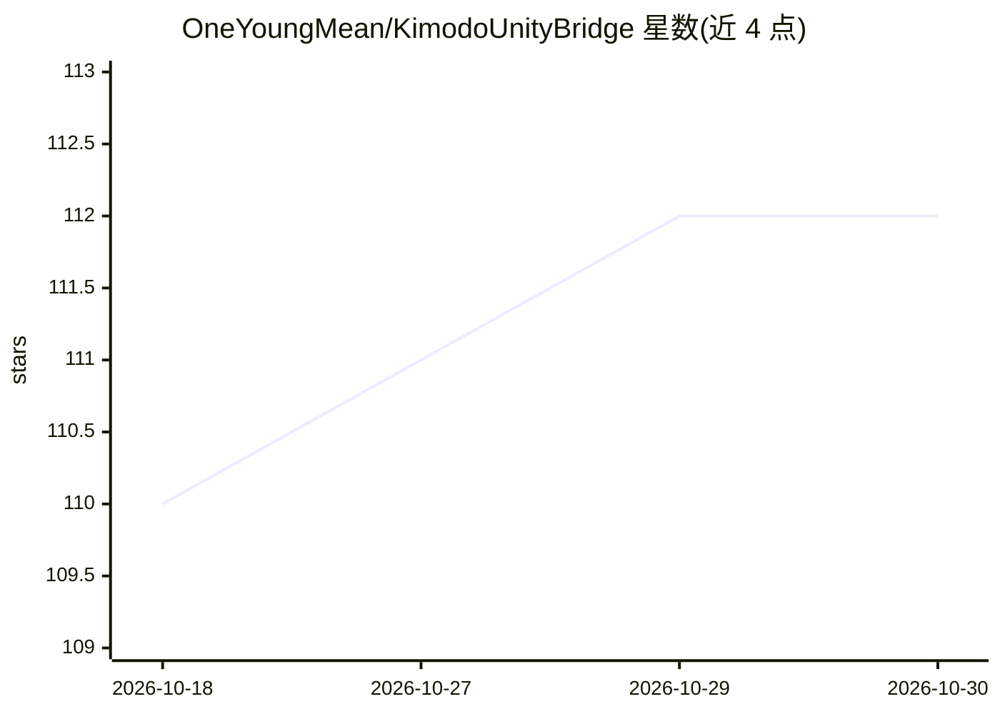

# OneYoungMean/KimodoUnityBridge

⭐ 112 · C# · Apache-2.0 · 推送 2026-10-29 · [GitHub](https://github.com/OneYoungMean/KimodoUnityBridge) · 个人维护 · 中文 README

**给 Unity 开发者：本地 AI 生成人形动画并烘焙到工程**

基于 NVIDIA Kimodo 模型的 Unity 包，在现有 Unity 工程内通过项目本地运行时生成人形动画：支持 prompt 驱动动作、姿态与末端执行器约束、动作分析、烘焙、重定向、Animator/Timeline 集成与运行时播放。跨 Windows/macOS/Linux，CUDA 为主要加速路径并带 CPU 回退；需 Unity 2022.3+、有效 Humanoid Animator 与至少 8 GB 内存。通过 Unity Package Manager 的 Git URL 安装，附带 QuickServer TCP 命令（含从图片/视频估计 SMPL-X 姿态）与面向 AI agent 的 SKILL.md 文档。

## 筛选速览

| 维度 | 判定 | 备注 |
|---|---|---|
| AI 角色 | `ai-native` | 本体是模型或模型工具 |
| 许可风险 | `permissive` | Apache-2.0 |
| 部署形态 | `None` |  |
| 模型依赖 | — | README 未给出锁定关系 |
| 硬件要求 | — | 无带数字的原话,不猜 |
| 安装摩擦 | `medium` | 含编译或系统依赖之一 |
| 成熟度 | — | 结构信号不足 |

## 能力要点

- prompt 驱动的人形动画生成、烘焙、重定向与 Timeline/Animator 集成
- 项目本地运行时，动画资产留在 Unity 工程内
- QuickServer TCP 异步命令（generate/pose.fromvideo/pose.frompicture 等）
- 附带 AI Agent 手册（SKILL.md）与命令定义 schema

## 适用场景

- 在 Unity 游戏工程中按文字提示生成角色动画
- 从图片或视频估计 SMPL-X 姿态用于动作分析
- 让 AI agent 通过命令接口自动执行动画工作流

## 场景标签

 · 领域:游戏开发/动画生成

## 证据(README 行号)

> L5: Kimodo adds local AI humanoid animation generation to an existing Unity project. It supports prompt-driven motion, p
> L36: 3. Enter a motion prompt and choose **Generate & Bake**.

## 星数曲线

2026-10-18 110 → 2026-10-30 112（+2）

---
*卡片 v1 · prompt 1.4 · 生成 2026-10-23 · 置信度 high · 依据 README sha `c6a8f297588b` · [字段定义](../../DATASET.md)*
