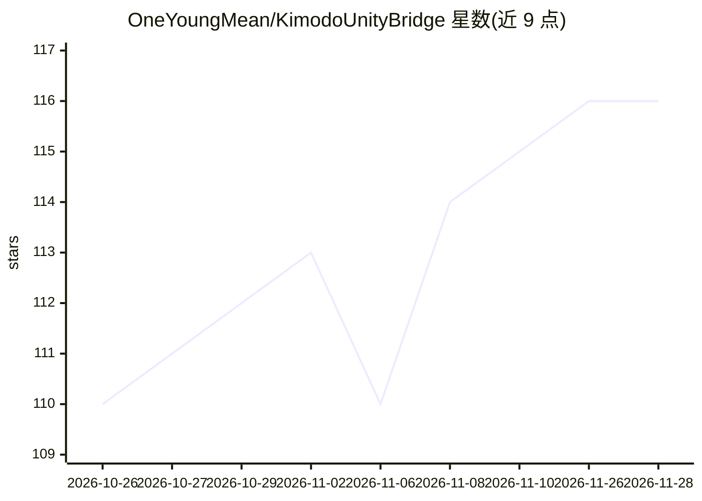

# OneYoungMean/KimodoUnityBridge

⭐ 116 · C# · Apache-2.0 · 推送 2026-11-26 · [GitHub](https://github.com/OneYoungMean/KimodoUnityBridge) · 个人维护 · 中文 README

**Unity 插件：为已有项目添加本地 AI 人形动画生成**

基于 NVIDIA Kimodo 的 Unity 包，向已有 Unity 项目添加本地运行的 AI 人形动画生成能力，支持提示词驱动动作、姿态与末端执行器约束、分析、烘焙、重定向、Animator 内容、Timeline 编排与运行时动作播放。运行时由项目自持，支持 Windows/macOS/Linux，CUDA 为主加速路径并有 CPU 回退；生成与资产保留在 Unity 项目工作流内。需 Unity 2022.3+、Humanoid Animator 角色与至少 8 GB 内存。

## 筛选速览

| 维度 | 判定 | 备注 |
|---|---|---|
| AI 角色 | `ai-native` | 本体是模型或模型工具 |
| 许可风险 | `permissive` | Apache-2.0 |
| 部署形态 | `None` |  |
| 模型依赖 | — | README 未给出锁定关系 |
| 硬件要求 | — | 无带数字的原话,不猜 |
| 安装摩擦 | `medium` | 含编译或系统依赖之一 |
| 成熟度 | — | 结构信号不足 |

## 能力要点

- 提示词驱动的动作、姿态与末端执行器约束生成
- 本地项目自持运行时，CUDA 主加速、CPU 回退
- 覆盖烘焙、重定向、Animator、Timeline 编排与运行时播放
- 可选 QuickServer 渲染生成动作为 MP4，并提供异步命令接口

## 适用场景

- 在 Unity 中用提示词生成角色动画并烘焙到 Timeline
- 为项目内人形角色做动作重定向与运行时播放
- 将生成动画渲染导出为 MP4 视频

## 场景标签

 · 领域:游戏开发/AI 动画

## 证据(README 行号)

> L5: Kimodo adds local AI humanoid animation generation to an existing Unity project. It supports prompt-driven motion, p
> L8: - Supports Windows, macOS, and Linux; CUDA is the primary acceleration path and CPU fallback is available.

## 星数曲线

2026-10-26 110 → 2026-11-28 116（+6）

---
*卡片 v1 · prompt 1.4 · 生成 2026-11-28 · 置信度 high · 依据 README sha `439a5b39906c` · [字段定义](../../DATASET.md)*
