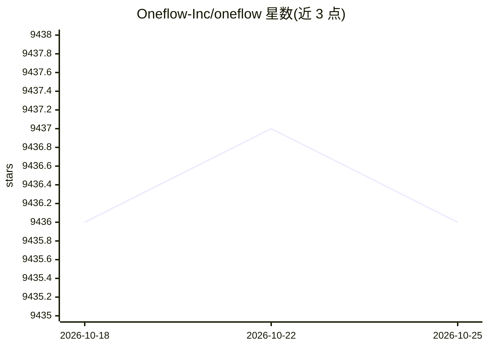

# Oneflow-Inc/oneflow

⭐ 9,438 · C++ · Apache-2.0 · 推送 2025-12-04 · [GitHub](https://github.com/Oneflow-Inc/oneflow) · [官网](http://www.oneflow.org) · 组织维护 · 中文 README

**分布式深度学习框架，提供类 PyTorch API 与编译加速**

由 OneFlow Inc 与之江实验室开发的深度学习框架：提供类 PyTorch 的编程 API，通过 Global Tensor 支持 n 维并行分布式训练，并含 Graph Compiler 用于模型加速与部署。要求 Linux 与 Python 3.7-3.11；CUDA 支持需 arch 60 以上、CUDA Toolkit 10.0+ 与 Nvidia 驱动 440.33+。安装方式含 pip、Docker 镜像与源码编译，配套 Libai（大规模 Transformer 并行训练）与 FlowVision（视觉工具箱）等模型库。Apache 2.0 许可。

## 筛选速览

| 维度 | 判定 | 备注 |
|---|---|---|
| AI 角色 | `ai-ecosystem` | LLM/agent 周边工具 |
| 许可风险 | `permissive` | Apache-2.0 |
| 部署形态 | `self-host` | docker 或自建部署 |
| 模型依赖 | — | README 未给出锁定关系 |
| 硬件要求 | `cpu-ok` | |
| 安装摩擦 | `low` | 无编译、无系统依赖或容器化 |
| 成熟度 | — | 结构信号不足 |

## 能力要点

- 类 PyTorch API 编程模型
- Global Tensor 支持 n 维并行分布式执行
- Graph Compiler 加速与部署模型
- 配套 Libai/FlowVision 模型工具箱与 Benchmark

## 适用场景

- 用类 PyTorch 接口编写并训练深度学习模型
- 将模型扩展到多机多卡 n 维并行训练
- 通过编译器加速模型推理部署

## 场景标签

`模型训练` · 领域:训练与推理

## 证据(README 行号)

> L3: OneFlow is a deep learning framework designed to be **user-friendly, scalable and efficient**. With OneFlow, it is e
> L5: - program a model with **PyTorch-like API**

## 星数曲线

2026-10-18 9,436 → 2026-10-25 9,436（+0）

---
*卡片 v1 · prompt 1.4 · 生成 2026-10-20 · 置信度 high · 依据 README sha `f9c3f8ba26e9` · [字段定义](../../DATASET.md)*
