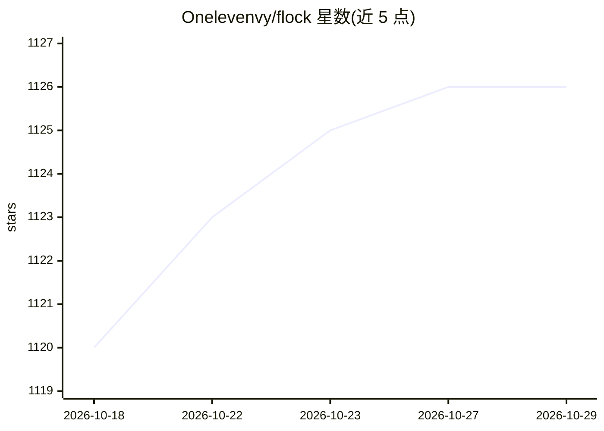

# Onelevenvy/flock

⭐ 1,126 · Rust · Apache-2.0 · 推送 2026-07-07 · [GitHub](https://github.com/Onelevenvy/flock) · 个人维护 · 中文 README

**桌面端多 agent 编排工具：可视化工作流+沙箱运行 AI agent**

基于 Rust/Tauri/React 的桌面多 agent harness，核心由作者自研的 langgraph-rust 驱动。提供 ReactFlow 可视化工作流编辑器（10 种节点类型）、内置零配置 agent、文件读写与 bash 执行、Playwright 浏览器自动化、隔离沙箱与 VNC 桌面接管、人工审批（HITL）、MCP 接入与 cron 定时任务。粘贴 OpenAI/Gemini/Claude/Bedrock/Ollama 等 API key 即可用。安装需从源码构建：Rust 1.77.2+ 与 Node.js 18+ 为前置条件，克隆仓库后 npm install 并以 npm run tauri dev 启动；早期 Python 版代码保留在 legacy 分支。

## 筛选速览

| 维度 | 判定 | 备注 |
|---|---|---|
| AI 角色 | `ai-native` | 本体是模型或模型工具 |
| 许可风险 | `permissive` | Apache-2.0 |
| 部署形态 | `library` | 以包/库形式分发 |
| 模型依赖 | local-ok | 支持本地模型 |
| 硬件要求 | — | 无带数字的原话,不猜 |
| 安装摩擦 | `low` | 无编译、无系统依赖或容器化 |
| 成熟度 | — | 结构信号不足 |

## 能力要点

- ReactFlow 可视化工作流编辑器，含 10 种节点类型与流式执行
- 隔离沙箱执行命令/代码，VNC 流式查看并可人工接管桌面
- 工具调用审批（HITL）与 human 节点断点
- MCP 服务器接入，所有助手与工作流自动继承其工具

## 适用场景

- 在桌面端可视化搭建并运行多 agent 工作流
- 让 agent 在沙箱内安全地执行文件操作、bash 命令与浏览器自动化
- 通过 cron 定时让 agent 无人值守执行例行任务

## 场景标签

`多智能体` `Agent 框架` `浏览器自动化` · 领域:Agent 开发

## 证据(README 行号)

> L3: A desktop multi-agent harness built with Rust, Tauri, and React, powered by langgraph-rust.
> L27: Flock is more than just a chat client. It's a comprehensive **multi-agent harness** combined with a powerful **Visu
> L61: * **Out of the box**: No external CLI tools to download or configure. Paste any API Key (OpenAI, Gemini, Anthropic 

## 星数曲线

2026-10-18 1,120 → 2026-10-29 1,126（+6）

---
*卡片 v1 · prompt 1.4 · 生成 2026-10-21 · 置信度 high · 依据 README sha `2b003e3a48dc` · [字段定义](../../DATASET.md)*
