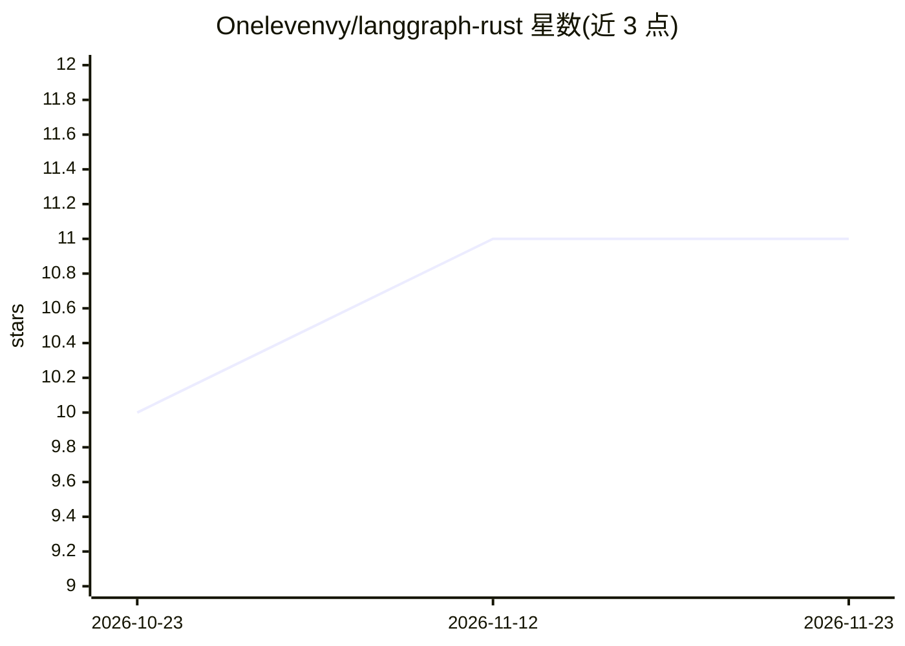

# Onelevenvy/langgraph-rust

⭐ 11 · Rust · MIT · 推送 2026-08-11 · [GitHub](https://github.com/Onelevenvy/langgraph-rust) · 个人维护

**LangGraph 的 Rust 实现：构建有状态多 actor LLM 应用框架**

将 LangGraph 核心概念移植到 Rust 的框架，提供 StateGraph 状态图、基于 tokio 的 Pregel BSP 并行引擎、带 reducer 的 Channels、检查点持久化（InMemory/Postgres/SQLite）、实时 tracing 服务与 UI，以及预构建的 ReAct Agent 与工具执行。通过 OpenAI 兼容接口接入模型，支持自定义 base_url 与环境变量配置。以 cargo crate 生态发布，含 9 个子 crate 与多个示例工程，许可证为 MIT。README 声明非官方 LangGraph 实现。

## 筛选速览

| 维度 | 判定 | 备注 |
|---|---|---|
| AI 角色 | `ai-ecosystem` | LLM/agent 周边工具 |
| 许可风险 | `permissive` | MIT |
| 部署形态 | `library` | 以包/库形式分发 |
| 模型依赖 | local-ok | 支持本地模型 |
| 硬件要求 | — | 无带数字的原话,不猜 |
| 安装摩擦 | `low` | 无编译、无系统依赖或容器化 |
| 成熟度 | `idea` | |

## 能力要点

- StateGraph 状态图与 Pregel BSP 并行执行引擎（tokio）
- 检查点持久化支持 InMemory、Postgres、SQLite
- 实时 tracing 服务器与 UI 可视化图执行与 LLM 调用
- 预构建 ReAct Agent、#[tool] 宏与 human-in-the-loop 中断恢复

## 适用场景

- 用 Rust 构建有状态的多 actor LLM Agent 应用
- 需要检查点持久化、暂停恢复与人工审批的工作流
- 通过 OpenAI 兼容接口对接 Ollama/vLLM 等本地模型
- 对图执行过程做实时追踪与调试（time-travel）

## 场景标签

`Agent 框架` `多智能体` · 领域:Agent 开发

## 证据(README 行号)

> L7: A Rust implementation of LangGraph -- a framework for building stateful, multi-actor applications with LLMs.
> L19: - **StateGraph** -- Directed graphs where nodes are async functions that transform state, and edges define control 

## 星数曲线

2026-10-23 10 → 2026-11-23 11（+1）

---
*卡片 v1 · prompt 1.4 · 生成 2026-11-19 · 置信度 high · 依据 README sha `5897d9477f15` · [字段定义](../../DATASET.md)*
