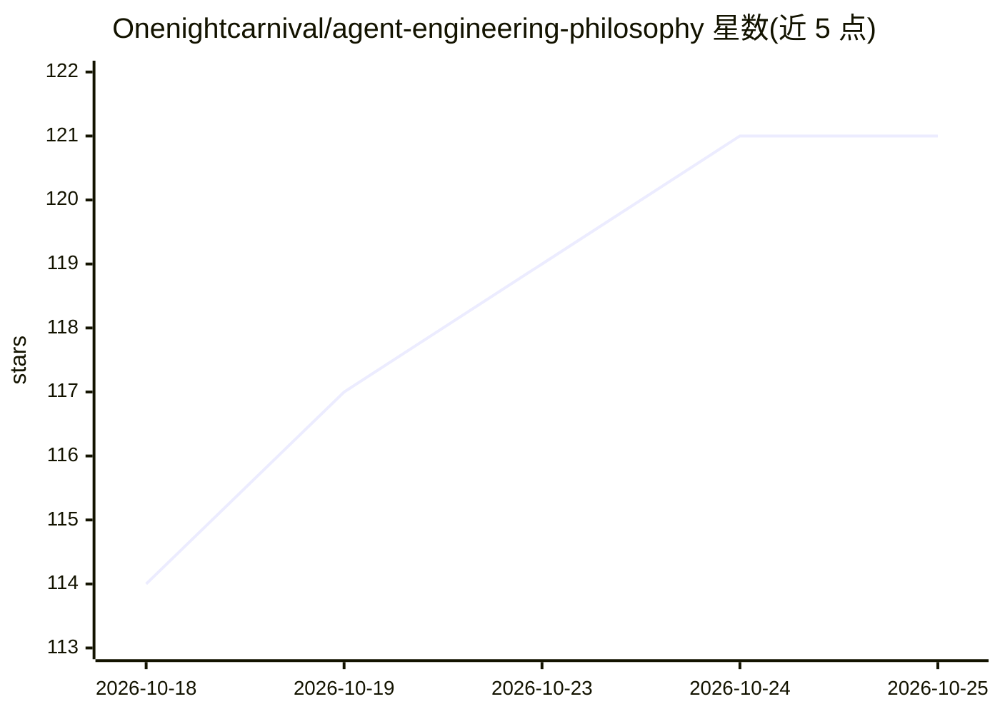

# Onenightcarnival/agent-engineering-philosophy

⭐ 123 · Shell · NOASSERTION · 推送 2026-08-03 · [GitHub](https://github.com/Onenightcarnival/agent-engineering-philosophy) · [官网](https://onenightcarnival.github.io/agent-engineering-philosophy/) · 个人维护 · 中文 README

**把 agent 视作打工人的 AI 工程哲学书籍（写作中）**

《大模型应用工程哲学》的续作，一本关于 agent 工程的哲学书（中文为主，双语目录），写作进行中。核心视角是把 agent 当打工人：系统提示词是 JD、skill 是可验证的职业证书、模型分级是学历、长期记忆是职业履历、持久化沙箱是工作电脑。全书按此抽象展开八章，从稳定抽象、岗位定义、skill、环境与记忆、eval 到多 agent 团队设计。它自称不是 agent 框架手册，也非 multi-agent 编排速查表。提供 GitHub Pages 在线阅读，许可为 CC BY-NC-SA 4.0。

## 筛选速览

| 维度 | 判定 | 备注 |
|---|---|---|
| AI 角色 | `ai-knowledge` | 知识聚合/清单类 |
| 许可风险 | `none` | NOASSERTION |
| 部署形态 | `None` |  |
| 模型依赖 | — | README 未给出锁定关系 |
| 硬件要求 | — | 无带数字的原话,不猜 |
| 安装摩擦 | `low` | 无编译、无系统依赖或容器化 |
| 成熟度 | `idea` | |

## 能力要点

- 以人力资源视角系统重构 agent 工程问题：JD/证书/学历/履历/工作电脑的类比体系
- 八章目录覆盖从个体抽象到多 agent 团队设计
- GitHub Pages 在线阅读，CC BY-NC-SA 4.0 许可

## 适用场景

- 想建立 agent 工程思维方式而非框架用法的读者阅读
- 作为第一本《大模型应用工程哲学》的进阶续作独立阅读

## 场景标签

`教程课程` · 领域:学习与行业

## 证据(README 行号)

> L1: # Agent 工程哲学
> L7: 第一本书从模型出发：模型是一个会出错的概率组件，工程要处理的是建在它之上的应用。这本书换了一个出发点：agent 这个自主角色——有岗位、有技能、有履历、有自己的工作环境。工程对象从"用模型搭应用"，转向"设计 agent 本身"。
> L27: > 写作进行中。章节按"打工人"这套抽象展开：先找到 agent 这个稳定抽象，再顺着它的一生往下写——候选人从哪里来、岗位怎么定、skill 怎么补、环境和履历怎么留、表现怎么验、什么时候该转岗或下线。最后从个体走到团队，讨论一

## 星数曲线

2026-10-18 114 → 2026-10-25 121（+7）

---
*卡片 v1 · prompt 1.4 · 生成 2026-10-23 · 置信度 high · 依据 README sha `987f7aa21d6e` · [字段定义](../../DATASET.md)*
