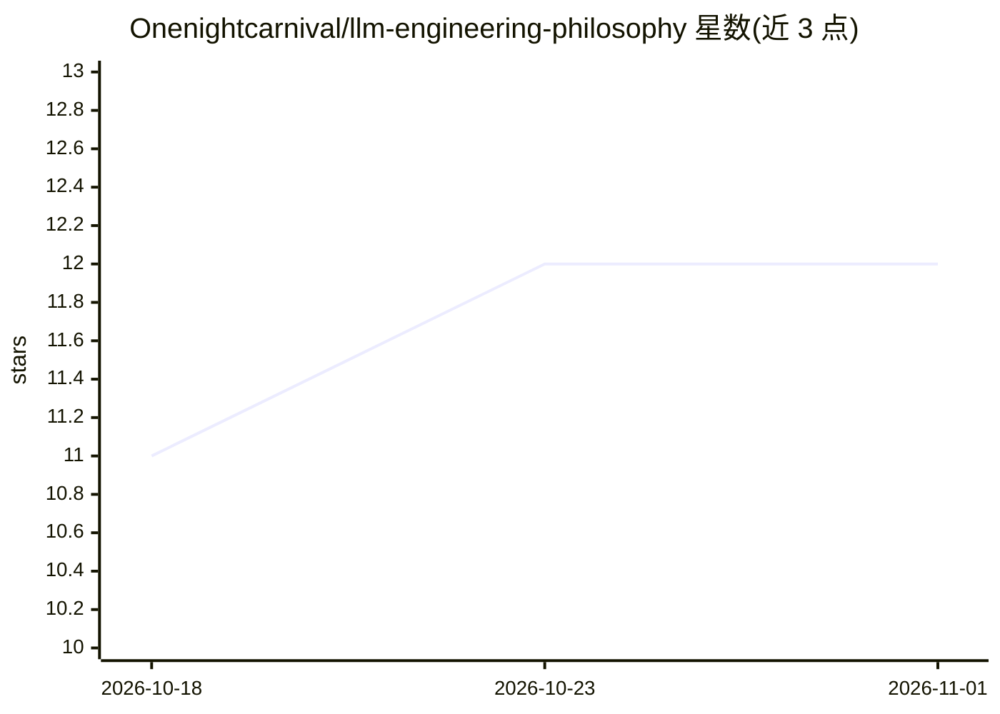

# Onenightcarnival/llm-engineering-philosophy

⭐ 12 · Lua · NOASSERTION · 推送 2026-06-09 · [GitHub](https://github.com/Onenightcarnival/llm-engineering-philosophy) · [官网](https://onenightcarnival.github.io/llm-engineering-philosophy/) · 个人维护 · 中文 README

**探讨大模型时代软件工程原则的中文书籍**

一个人撰写的系统性著作，讨论当软件系统核心组件从确定性函数变为概率性语言模型时，软件工程需要调整什么、什么不变。内容覆盖大模型的本质边界、不确定性决策、人机协作过程、声明式提示与类型契约、架构与编排、测试评估与可观测性、反模式等八章。定位为'怎么想'而非教程或框架指南，含第七章试读与完整目录，通过 GitHub Pages 在线阅读，许可为 CC BY-NC-SA 4.0。

## 筛选速览

| 维度 | 判定 | 备注 |
|---|---|---|
| AI 角色 | `ai-knowledge` | 知识聚合/清单类 |
| 许可风险 | `none` | NOASSERTION |
| 部署形态 | `None` |  |
| 模型依赖 | — | README 未给出锁定关系 |
| 硬件要求 | — | 无带数字的原话,不猜 |
| 安装摩擦 | `low` | 无编译、无系统依赖或容器化 |
| 成熟度 | — | 结构信号不足 |

## 能力要点

- 八章结构：从认识论到架构编排、测试评估、反模式
- 提出 Code as Prompt 与 Schema as Workflow 两个核心概念
- 声明个人立场写作，不依赖权威背书

## 适用场景

- 系统性理解 LLM 对软件工程原则的影响
- LLM 应用开发者反思 prompt 堆叠规则等反模式
- 寻找架构、编排与测试的方法论参考

## 场景标签

`教程课程` · 领域:学习与行业

## 证据(README 行号)

> L5: 大模型应用领域正在被大量"怎么做"的内容淹没——教程、速查表、框架文档、awesome 列表。它们共享一个盲区：没有人退后一步问，当软件系统的核心组件从确定性函数变成概率性语言模型，软件工程本身需要做出什么调整。
> L7: 这本书关注的是"怎么想"，然后才是"怎么做"。不是 prompt 技巧手册，不是框架使用指南，不是模型评测报告。是一个人对"大模型时代的软件工程应该是什么样子"的系统性回答。有明确的偏好、明确的判断、明确的品味。
> L35: ## 完整目录

## 星数曲线

2026-10-18 11 → 2026-11-01 12（+1）

---
*卡片 v1 · prompt 1.4 · 生成 2026-11-01 · 置信度 high · 依据 README sha `f55086d15d8d` · [字段定义](../../DATASET.md)*
