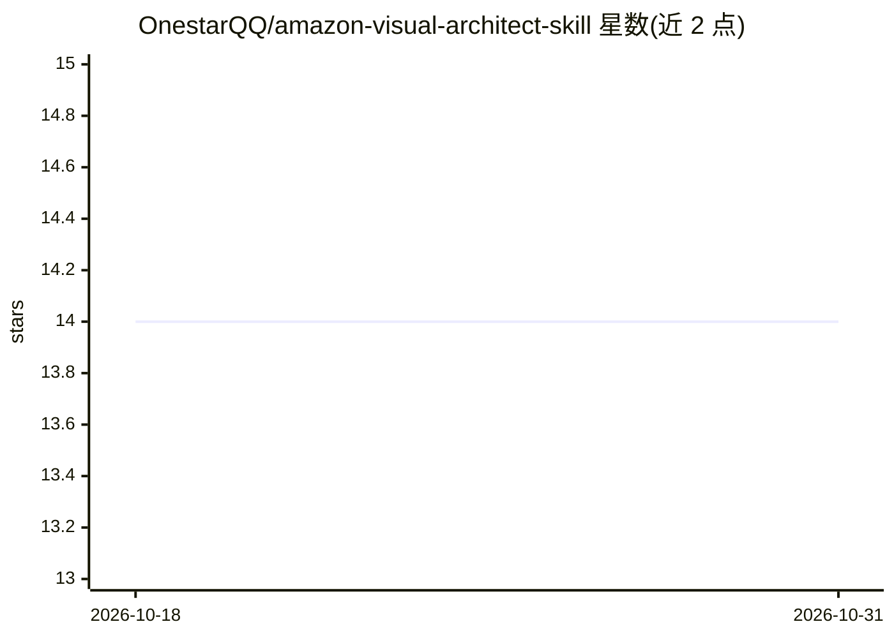

# OnestarQQ/amazon-visual-architect-skill

⭐ 14 · Python · 推送 2026-03-17 · [GitHub](https://github.com/OnestarQQ/amazon-visual-architect-skill) · 个人维护 · 中文 README

**亚马逊商品套图 Prompt 生成的 AI 技能包，面向电商卖家**

以 SKILL.md 形式提供的电商视觉设计技能包：分析产品特性，提取品牌基因（主色/字体/图标风格），按 15 种布局模板（Listing L1-L7、A+ 页面 A1-A9）批量生成可直接用于 AI 绘图平台的商品主图与 A+ 页面设计 Prompt。支持多区域文化适配、多语言文字生成、侵权词过滤，通过 customer_keywords、salesRegion、目标受众等参数配置调用，可批量处理多产品并继承品牌基因。供 Claude 类 agent 框架（如 openclaw）用户及电商卖家使用。

## 筛选速览

| 维度 | 判定 | 备注 |
|---|---|---|
| AI 角色 | `ai-knowledge` | 知识聚合/清单类 |
| 许可风险 | `none` | — |
| 部署形态 | `None` |  |
| 模型依赖 | — | README 未给出锁定关系 |
| 硬件要求 | — | 无带数字的原话,不猜 |
| 安装摩擦 | `low` | 无编译、无系统依赖或容器化 |
| 成熟度 | — | 结构信号不足 |

## 能力要点

- 15 种专业布局模板（Listing L1-L7 / A+ A1-A9）
- 品牌基因提取与多产品批量继承机制
- 多区域文化适配与中英日多语言支持
- 内置侵权词过滤与平台合规约束

## 适用场景

- 为 Amazon Listing 与 A+ 页面批量生成设计 Prompt
- 多产品线统一品牌视觉基因
- 面向不同区域市场做本土化商品图设计

## 场景标签

`提示工程` · 领域:Agent 开发

## 证据(README 行号)

> L3: > 🎯 亚马逊商品套图生成 AI 技能包 v1.0
> L8: Amazon Visual Architect 是一个专业的电商视觉设计 AI 技能，能够智能分析产品特性，提取统一品牌基因，生成高质量的 Amazon Listing 主图和 A+ 页面设计 Prompt。
> L86: ├── SKILL.md          # 技能说明文档

## 星数曲线

2026-10-18 14 → 2026-10-31 14（+0）

---
*卡片 v1 · prompt 1.4 · 生成 2026-10-31 · 置信度 mid · 依据 README sha `d3e057860be8` · [字段定义](../../DATASET.md)*
