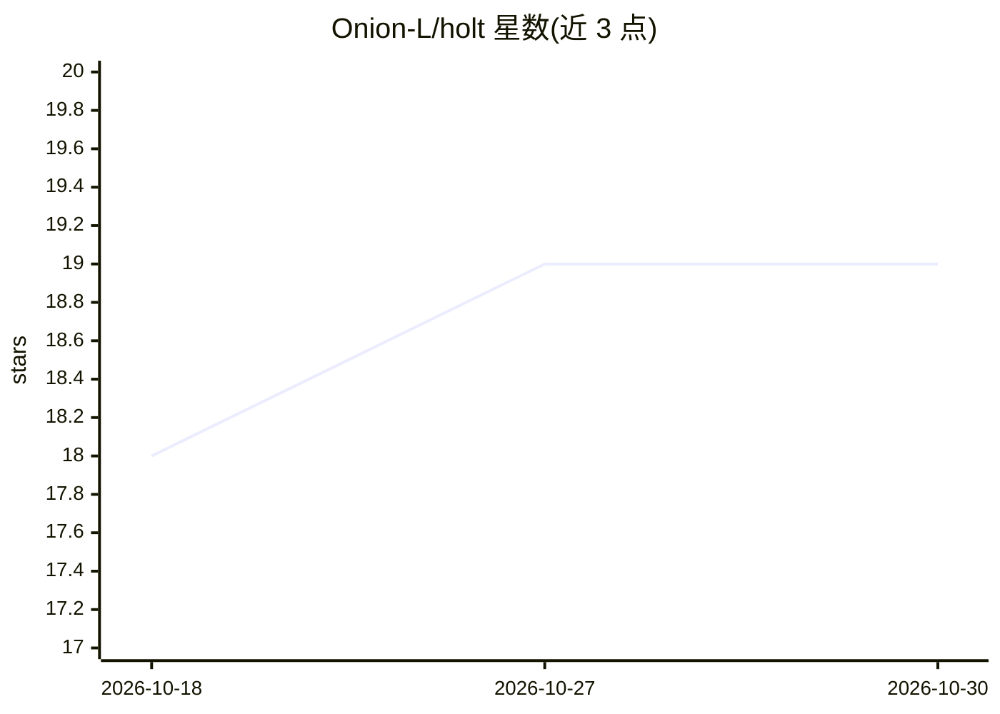

# Onion-L/holt

⭐ 19 · Rust · GPL-3.0 · 推送 2026-10-29 · [GitHub](https://github.com/Onion-L/holt) · [官网](https://holtagent.cc) · 个人维护 · 中文 README

**macOS 本地编码 agent 桌面应用：崩溃恢复与任意步骤回退**

用 Rust 与 GPUI 构建的本地桌面编码 agent。核心机制：进程被 kill 或崩溃后，下次启动自动恢复孤儿进程并告知模型中断期间哪些文件变更，从中断处继续而非重来；每个触碰文件的工具调用记录前后字节，可悬停工具卡片回退到任意步骤（对话与文件一并回退）。数据全部本地存储于 ~/.holt，无云端、无遥测；支持自定义模型 Provider、MCP、subagents 与可插拔搜索（Zhipu/Bocha/Brave）。目前仅支持 macOS，自述为实验性项目。

## 筛选速览

| 维度 | 判定 | 备注 |
|---|---|---|
| AI 角色 | `ai-native` | 本体是模型或模型工具 |
| 许可风险 | `viral` | GPL-3.0 |
| 部署形态 | `None` |  |
| 模型依赖 | — | README 未给出锁定关系 |
| 硬件要求 | — | 无带数字的原话,不猜 |
| 安装摩擦 | `low` | 无编译、无系统依赖或容器化 |
| 成熟度 | `idea` | |

## 能力要点

- 崩溃后自动恢复孤儿进程并续跑中断的 Turn
- 任意工具步骤的文件级检查点与整体回退（含并行兄弟调用）
- 本地-only：数据存于 ~/.holt，无账号/同步/遥测
- 可扩展：MCP servers、subagents、可插拔 web 搜索（Zhipu/Bocha/Brave）

## 适用场景

- 长时间编码任务中进程被杀后不丢失进度地续跑
- agent 改错文件后回退到之前的任意步骤
- 在本地跑编码 agent 并自带 API key 选择模型

## 场景标签

`编码 Agent` · 领域:编码与开发

## 证据(README 行号)

> L5:  A local coding agent that survives crashes and lets you rewind any step.
> L22: - **Survives crashes.** When the app is killed mid-run, Holt restores orphan processes, tells the model exactly whi
> L29: - **Crash recovery** — a Turn interrupted by `kill -9` or a crash resumes automatically on the next launch: orphan 

## 星数曲线

2026-10-18 18 → 2026-10-30 19（+1）

---
*卡片 v1 · prompt 1.4 · 生成 2026-10-28 · 置信度 high · 依据 README sha `a2db1532f0dc` · [字段定义](../../DATASET.md)*
