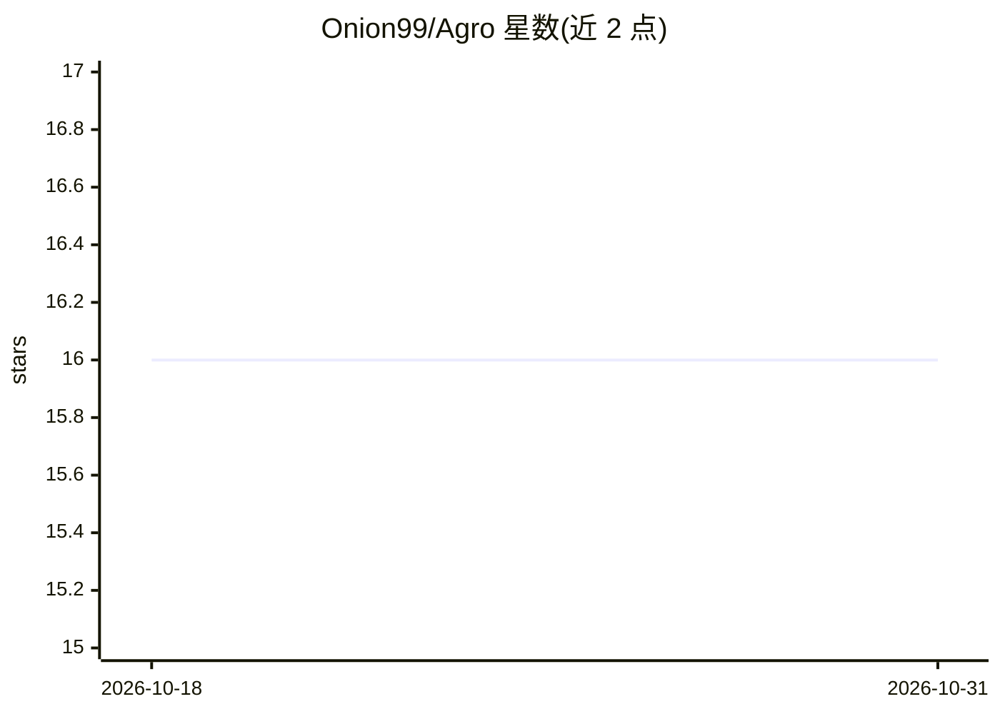

# Onion99/Agro

⭐ 16 · Kotlin · GPL-3.0 · 推送 2026-09-04 · [GitHub](https://github.com/Onion99/Agro) · [官网](https://github.com/Onion99/Agro/releases) · 个人维护 · 中文 README

**跨平台本地 LLM 与 Agent 聊天客户端，数据全程在设备上**

面向终端用户的本地大模型对话与自主 Agent 应用，覆盖 Android、iOS、macOS、Windows、Linux 五端，基于 Kotlin Multiplatform 与 Compose Multiplatform 构建。推理引擎为 Google LiteRT-LM C++ 运行时，支持 Metal/WebGPU/DirectX/Vulkan/OpenCL 硬件加速，GPU 出错时自动回退 CPU。内置工具调用循环（本地 JavaScript 执行、Bing 网页搜索、URL 内容分析，默认最多 10 轮迭代），支持流式对话、上下文预算与历史裁剪，可下载 Ministral-3-3B 与 Gemma 4 4B 模型。GPL-3.0 许可。

## 筛选速览

| 维度 | 判定 | 备注 |
|---|---|---|
| AI 角色 | `ai-native` | 本体是模型或模型工具 |
| 许可风险 | `viral` | GPL-3.0 |
| 部署形态 | `desktop` | 安装包/桌面程序 |
| 模型依赖 | — | README 未给出锁定关系 |
| 硬件要求 | — | 无带数字的原话,不猜 |
| 安装摩擦 | `medium` | 含编译或系统依赖之一 |
| 成熟度 | — | 结构信号不足 |

## 能力要点

- 五平台预编译发布包（apk/ipa/exe/dmg/AppImage 等）
- LiteRT-LM 本地推理，Metal/WebGPU/DirectX/Vulkan/OpenCL 加速，GPU 失败自动回退 CPU
- Agent 工具循环：本地 JS 执行、searchWeb、analyzeUrl，默认最多 10 轮迭代
- 多模态结构化生成：SVG 矢量图、8-bit 音频、Lottie 动画在端上渲染

## 适用场景

- 在不联网的设备上与本地 LLM 对话，数据不出本机
- 通过内置工具循环让模型执行搜索与网页分析任务
- 在手机和桌面使用同一应用进行本地模型对话与创意生成

## 场景标签

`聊天机器人` `AI 助手` · 领域:对话与助手

## 证据(README 行号)

> L27: **Agro** is a pure on-device, multi-platform (Android, iOS, macOS, Windows, Linux) **local Large Language Model (LL
> L29: Unlike conventional AI tools that depend on remote cloud APIs, Agro brings the entire inference engine, context sch

## 星数曲线

2026-10-18 16 → 2026-10-31 16（+0）

---
*卡片 v1 · prompt 1.4 · 生成 2026-10-30 · 置信度 high · 依据 README sha `ec64c13c76e4` · [字段定义](../../DATASET.md)*
