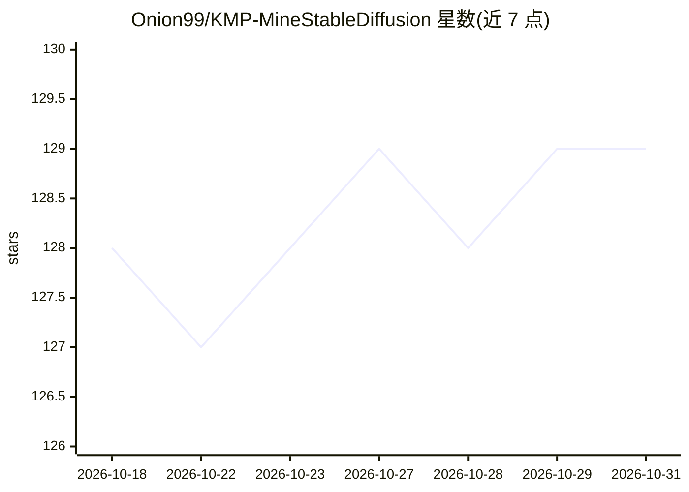

# Onion99/KMP-MineStableDiffusion

⭐ 129 · Kotlin · GPL-3.0 · 推送 2026-07-14 · [GitHub](https://github.com/Onion99/KMP-MineStableDiffusion) · 个人维护

**Kotlin 多平台本地 AI 绘图客户端：手机/桌面离线运行 Stable Diffusion**

基于 Kotlin Multiplatform 与 Compose 的跨平台 AI 图像生成应用，通过 C++ 后端（stable-diffusion.cpp）与 JNI 绑定在本地运行推理，支持 Android、iOS、Windows/macOS/Linux。支持 SD-Turbo、SDXL、SD3、FLUX 等 .gguf/.safetensors 模型，提供 LoRA 拖放混合、采样器切换、量化与 CPU Offload 等显存控制，导出 PNG 内嵌生成参数。全部离线运行，不依赖云端。通过 Releases 安装包或源码构建获取。

## 筛选速览

| 维度 | 判定 | 备注 |
|---|---|---|
| AI 角色 | `ai-native` | 本体是模型或模型工具 |
| 许可风险 | `viral` | GPL-3.0 |
| 部署形态 | `desktop` | 安装包/桌面程序 |
| 模型依赖 | — | README 未给出锁定关系 |
| 硬件要求 | — | 无带数字的原话,不猜 |
| 安装摩擦 | `low` | 无编译、无系统依赖或容器化 |
| 成熟度 | `idea` | |

## 能力要点

- C++/JNI 原生后端，跨 Android/iOS/桌面离线推理
- 支持 SD1.x/SDXL/SD3/FLUX/Chroma 等多架构模型
- LoRA 拖放混合加载与采样器切换
- 量化、CPU Offload 等 VRAM 控制选项，PNG 内嵌生成参数

## 适用场景

- 在手机或桌面离线生成 AI 图像，数据不出设备
- 批量文生图并叠加多个 LoRA 风格
- 低显存设备上通过量化与 CPU Offload 运行大模型

## 场景标签

`图像生成` · 领域:内容生成

## 证据(README 行号)

> L5: **The kotlin multiplatform Stable Diffusion client**
> L26: Mine StableDiffusion is a **native, offline-first AI art generation studio** resting right in your pocket or on you
> L30: - 🚀 **Native Performance** — Pure C++ backend combined with JNI bindings ensures maximum hardware utilization.

## 星数曲线

2026-10-18 128 → 2026-10-31 129（+1）

---
*卡片 v1 · prompt 1.4 · 生成 2026-10-23 · 置信度 high · 依据 README sha `b7c53e237c44` · [字段定义](../../DATASET.md)*
