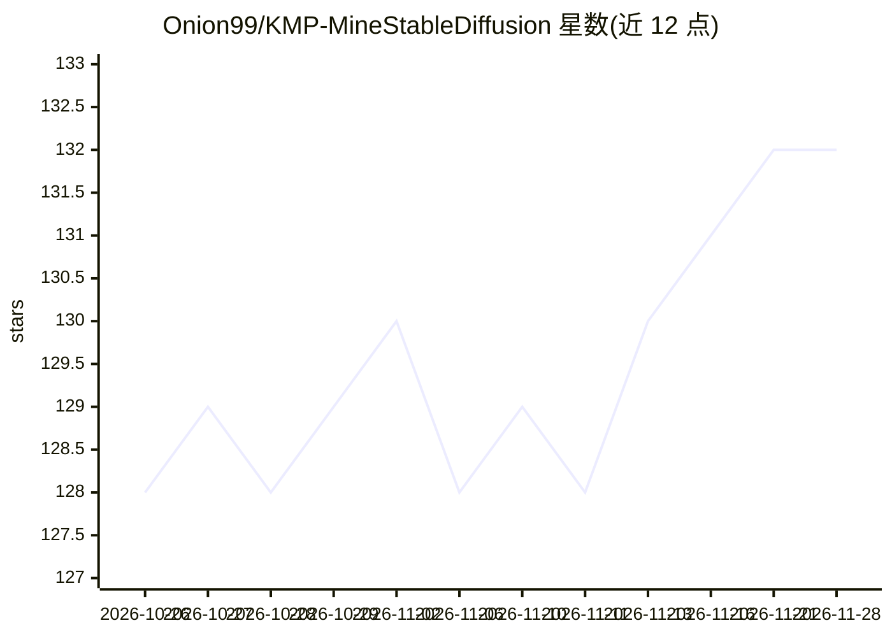

# Onion99/KMP-MineStableDiffusion

⭐ 132 · Kotlin · GPL-3.0 · 推送 2026-11-03 · [GitHub](https://github.com/Onion99/KMP-MineStableDiffusion) · 个人维护 · 中文 README

**安卓/iOS/桌面本地离线运行 Stable Diffusion 生图应用**

基于 Kotlin Multiplatform 与 Compose 的跨平台 Stable Diffusion 客户端，底层通过 JNI 调用 stable-diffusion.cpp 引擎在本地设备离线推理生图。支持 SD1.x/SDXL/SD3/FLUX 等架构与 GGUF/SAFETENSORS 模型文件，提供批量生成、多 LoRA 混合、采样器切换、量化与 CPU offload 等 VRAM 控制，生成参数自动嵌入导出 PNG。提供 .apk/.dmg/.exe 安装包，也可从源码构建。

## 筛选速览

| 维度 | 判定 | 备注 |
|---|---|---|
| AI 角色 | `ai-native` | 本体是模型或模型工具 |
| 许可风险 | `viral` | GPL-3.0 |
| 部署形态 | `desktop` | 安装包/桌面程序 |
| 模型依赖 | — | README 未给出锁定关系 |
| 硬件要求 | — | 无带数字的原话,不猜 |
| 安装摩擦 | `low` | 无编译、无系统依赖或容器化 |
| 成熟度 | — | 结构信号不足 |

## 能力要点

- 本地离线推理，无云端依赖，C++/JNI 后端
- 支持 SD-Turbo/SD1.x/SDXL/SD3/FLUX 等模型架构
- 多 LoRA 混合与量化（F16/Q8_0/Q4_K）、CPU offload 等显存控制
- 导出 PNG 自动嵌入全部生成参数

## 适用场景

- 在手机上离线生成 AI 图像
- 在桌面端用本地模型做文生图创作
- 低显存设备上通过量化与 offload 运行较大模型

## 场景标签

`图像生成` · 领域:内容生成

## 证据(README 行号)

> L26: Mine StableDiffusion is a **native, offline-first AI art generation studio** resting right in your pocket or on you
> L110: |🤖 **Android**|✅ Stable|Android 11+ (API 30+) running **Vulkan 1.2+**|

## 星数曲线

2026-10-26 128 → 2026-11-28 132（+4）

---
*卡片 v1 · prompt 1.4 · 生成 2026-11-28 · 置信度 high · 依据 README sha `f0fbfc0ab8b3` · [字段定义](../../DATASET.md)*
