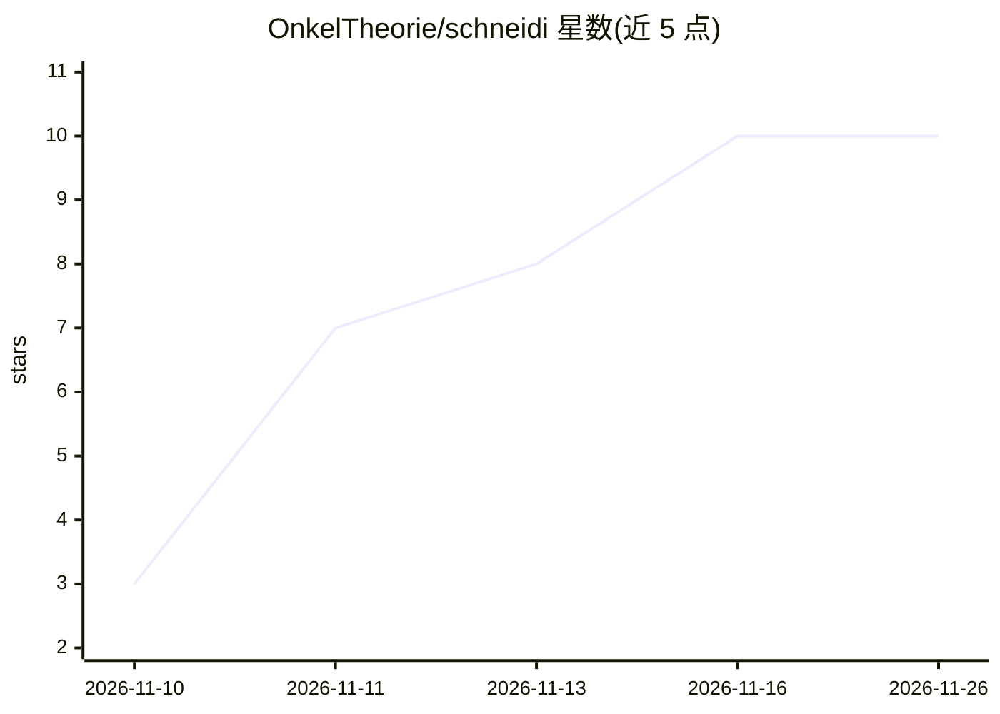

# OnkelTheorie/schneidi

⭐ 10 · C++ · AGPL-3.0 · 推送 2026-11-21 · [GitHub](https://github.com/OnkelTheorie/schneidi) · [官网](https://github.com/OnkelTheorie/schneidi/releases/latest) · 个人维护

**可与 AI 助手对话协作剪辑的开源 Linux 视频编辑器**

面向 Linux 的开源视频编辑器，含剪辑、合成、调色、混音、交付六个页面，支持多轨时间线、16 机位多机位、节点合成、调色轮与模板批量出片。AI 方面：应用内聊天（Claude、OpenAI 兼容服务、本地 Ollama），同时作为 MCP server 与 CLI 供 Claude Code、Cursor 等 AI 客户端驱动剪辑、渲染；离线字幕由 whisper.cpp 完成，处理全程本地化、无遥测。提供 AppImage/.deb/.pkg 安装包，状态为 0.x 早期开发，项目文件格式可能变动。

## 筛选速览

| 维度 | 判定 | 备注 |
|---|---|---|
| AI 角色 | `ai-enhanced` | 去掉 AI 部分产品仍成立 |
| 许可风险 | `viral` | AGPL-3.0 |
| 部署形态 | `desktop` | 安装包/桌面程序 |
| 模型依赖 | local-ok | 支持本地模型 |
| 硬件要求 | — | 无带数字的原话,不猜 |
| 安装摩擦 | `high` | 编译与系统依赖俱全 |
| 成熟度 | `idea` | |

## 能力要点

- 应用内 AI 聊天与 MCP server/CLI 三种 AI 接入方式
- whisper.cpp 离线语音识别与逐词字幕，全程本地运行
- 16 机位多机位、节点图合成、调色轮与 5.1/7.1 混音
- 模板占位符 + CSV 批量填充，一键生成 9:16 短视频

## 适用场景

- 让 AI 助手通过对话完成去停顿、卡点剪辑、调色与渲染
- 游戏录像一键转成带卡拉OK字幕的竖屏短视频
- 用模板批量产出带品牌素材的系列视频
- 低配置电脑或树莓派上做多机位剪辑与调色

## 场景标签

 · 领域:视频编辑/桌面工具

## 证据(README 行号)

> L3: **A fast, light video editor that an AI assistant can edit with you – live, in the project you have open.**
> L23: - **Edit together with an AI – any AI, any way.** Tell it what to do in the AI chat next to the timeline (Claude, a
> L28: - **Everything stays on your computer.** Speech recognition (whisper.cpp), text-based editing, sync by sound and re

## 星数曲线

2026-11-10 3 → 2026-11-26 10（+7）

---
*卡片 v1 · prompt 1.4 · 生成 2026-11-20 · 置信度 high · 依据 README sha `b0010e971465` · [字段定义](../../DATASET.md)*
