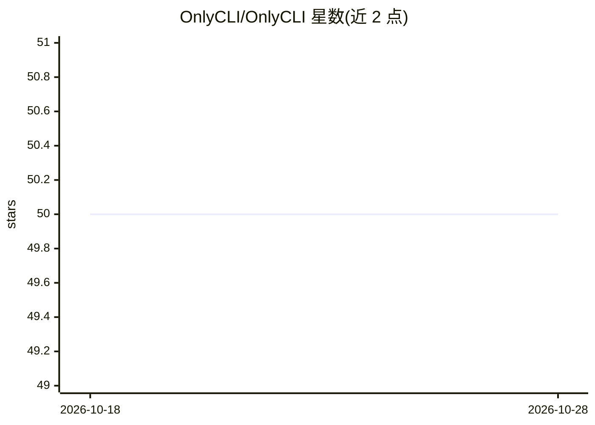

# OnlyCLI/OnlyCLI

⭐ 50 · Go · MIT · 推送 2026-03-30 · [GitHub](https://github.com/OnlyCLI/OnlyCLI) · [官网](https://onlycli.github.io/OnlyCLI/) · 组织维护

**将 OpenAPI 规范生成为原生 CLI 二进制，供 AI agent 低 token 调用**

用 Go 编写的代码生成工具：读取任意 OpenAPI 3.x 规范（本地文件或 URL），一次性生成单二进制 CLI，spec 中每个 operation 变为带 flags、帮助文本与 shell 补全的类型化命令。生成的 CLI 附带 7 种输出格式、字段投影、Go 模板输出、多方案自动分页、SSE/NDJSON 流式、OAuth2 设备流、多 profile、重试与 dry-run 等能力。面向 AI agent 场景，主张用 CLI --help 的按需发现替代 MCP 服务器的 schema 注入以降低 token 成本；亦供开发者直接调用 REST API。一条 go install 命令安装，支持 Linux/macOS/Windows 的 amd64/arm64。

## 筛选速览

| 维度 | 判定 | 备注 |
|---|---|---|
| AI 角色 | `ai-ecosystem` | LLM/agent 周边工具 |
| 许可风险 | `permissive` | MIT |
| 部署形态 | `library` | 以包/库形式分发 |
| 模型依赖 | — | README 未给出锁定关系 |
| 硬件要求 | — | 无带数字的原话,不猜 |
| 安装摩擦 | `low` | 无编译、无系统依赖或容器化 |
| 成熟度 | — | 结构信号不足 |

## 能力要点

- 从 OpenAPI 3.x spec 生成单二进制 CLI，每 operation 一个类型化命令
- 生成 CLI 含 7 种输出格式、字段投影、自动分页、流式、OAuth2、重试等能力
- 面向 AI agent 的按需命令发现（--help 约 200 tokens），替代 MCP schema 注入
- 跨平台单二进制，无运行时依赖

## 适用场景

- 让 AI agent 通过稳定 CLI 命令调用 REST API，减少上下文占用
- 从 GitHub API 等 OpenAPI 规范快速生成可用的命令行工具
- 开发/运维人员用类型化命令与格式化输出替代手写 curl

## 场景标签

`代码生成` · 领域:编码与开发

## 证据(README 行号)

> L7: **Turn any OpenAPI spec into a complete CLI. One command. One binary. 35x fewer tokens than MCP.**
> L83: ## For AI Agents: 35x Cheaper Than MCP
> L89: 1. Generate a binary once from the spec

## 星数曲线

2026-10-18 50 → 2026-10-28 50（+0）

---
*卡片 v1 · prompt 1.4 · 生成 2026-10-24 · 置信度 high · 依据 README sha `54de54d6d8fb` · [字段定义](../../DATASET.md)*
