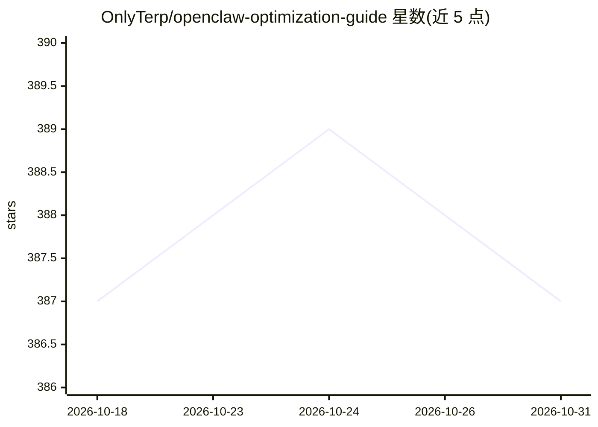

# OnlyTerp/openclaw-optimization-guide

⭐ 387 · JavaScript · MIT · 推送 2026-07-01 · [GitHub](https://github.com/OnlyTerp/openclaw-optimization-guide) · [官网](https://x.com/OnlyTerp) · 个人维护

**OpenClaw AI agent 的生产优化指南（33 部分）**

面向在生产环境运行 OpenClaw AI agent 的运维者与开发者的实践指南，共 33 部分，覆盖速度优化、上下文工程、内存架构（SOUL/AGENTS/MEMORY 文件分层）、模型选型、编排与安全加固，基于 OpenClaw 2026.6.11 稳定基线撰写，并附勘误说明此前版本引用了未发布的配置项。随指南附带可复制的 50 项生产就绪评分卡、配置模板、可复现基准方法学与社区规范文件，另有 GitHub Pages 渲染站点。MIT 许可，接受 PR。

## 筛选速览

| 维度 | 判定 | 备注 |
|---|---|---|
| AI 角色 | `ai-knowledge` | 知识聚合/清单类 |
| 许可风险 | `permissive` | MIT |
| 部署形态 | `library` | 以包/库形式分发 |
| 模型依赖 | — | README 未给出锁定关系 |
| 硬件要求 | — | 无带数字的原话,不猜 |
| 安装摩擦 | `low` | 无编译、无系统依赖或容器化 |
| 成熟度 | — | 结构信号不足 |

## 能力要点

- 33 部分指南覆盖速度、内存、编排、安全、可观测性
- 50 项生产就绪评分卡（满分 100，可复制分享）
- 附 SOUL/AGENTS/MEMORY/TOOLS 模板与示例配置
- 可复现基准方法学与提交自有数据的 PR 契约

## 适用场景

- 生产环境 OpenClaw agent 的提速、降本与内存管理
- 用评分卡审计现有 agent 部署的就绪程度
- 从旧版本迁移到 v4.x 时查找升级路径与回滚方案

## 场景标签

`教程课程` · 领域:学习与行业

## 证据(README 行号)

> L81: - **Running any OpenClaw agent in production.** If your bot handles real work, the speed, memory, and security part
> L110: - **SCORECARD.md** — The OpenClaw Production Readiness Scorecard. 50 items across Speed / Memory / Orchestration /

## 星数曲线

2026-10-18 387 → 2026-10-31 387（+0）

---
*卡片 v1 · prompt 1.4 · 生成 2026-10-21 · 置信度 mid · 依据 README sha `f55ee3ee83b7` · [字段定义](../../DATASET.md)*
