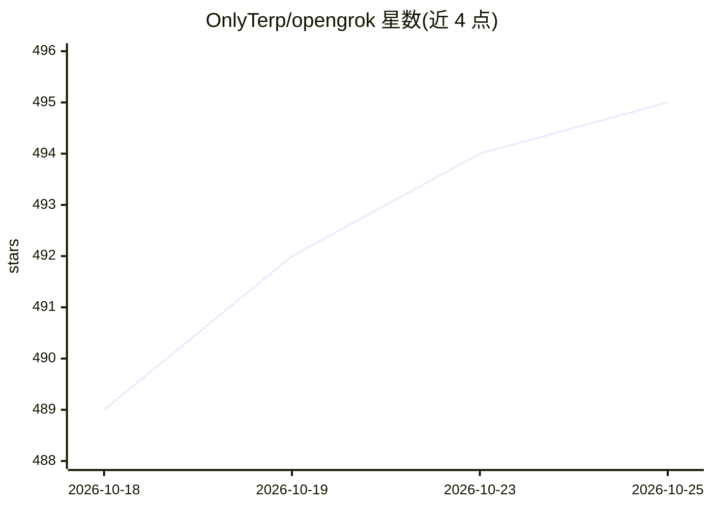

# OnlyTerp/opengrok

⭐ 495 · JavaScript · MIT · 推送 2026-09-22 · [GitHub](https://github.com/OnlyTerp/opengrok) · [官网](https://github.com/OnlyTerp/opengrok#-quick-start) · 个人维护

**让 Grok Bot 使用任意模型的配置工具与模型切换面板**

面向已安装 Grok Bot 桌面端的用户，opengrok 作为配置边车写入模型绑定与各提供商的 wire map（Grok/GLM/Claude/Gemini/DeepSeek/本地 llama.cpp），并注入应用内 LiquidGlass HUD，支持对话中途切换模型、逐机器人遥测与 256k 上下文监控。doctor 基线化本机文件并在 Grok Bot 更新后报告漂移、自动重注入 HUD。附带 OpenAI Responses↔Chat Completions 协议桥与本地实时语音助手（STT/实时模型/ElevenLabs TTS）。要求 Python 3.9+ 与 Node 18+，密钥留在本机。

## 筛选速览

| 维度 | 判定 | 备注 |
|---|---|---|
| AI 角色 | `ai-ecosystem` | LLM/agent 周边工具 |
| 许可风险 | `permissive` | MIT |
| 部署形态 | `None` |  |
| 模型依赖 | locked-api |  |
| 硬件要求 | — | 无带数字的原话,不猜 |
| 安装摩擦 | `low` | 无编译、无系统依赖或容器化 |
| 成熟度 | — | 结构信号不足 |

## 能力要点

- 按模型家族的 wire map：token 级 thinking/effort/fast 映射，附 wire-captures 抓包佐证
- 应用内 LiquidGlass HUD：对话中换模型、验证 hop、逐机器人遥测与上下文监护
- doctor.py 基线化机器，Grok Bot 更新后检测漂移并自动重注入 HUD
- 本地依赖免费的 Responses↔Chat Completions 协议桥与实时语音助手

## 适用场景

- 给 Grok Bot 各 agent 绑定 Claude/GLM/Gemini/DeepSeek/本地模型
- Grok Bot 更新后自动检测配置漂移并修复注入
- 在 Grok Bot 内实时切换模型并查看延迟与 token 流遥测

## 场景标签

`模型网关` `语音 Agent` · 领域:Agent 开发

## 证据(README 行号)

> L35: > **What this repo is — and is not.** opengrok is a **config sidecar for an
> L41: > OpenAI-compatible base URL (the "OpenAI-compatible base URL" you'd paste in

## 星数曲线

2026-10-18 489 → 2026-10-25 495（+6）

---
*卡片 v1 · prompt 1.4 · 生成 2026-10-22 · 置信度 high · 依据 README sha `5c7aa56a6cbe` · [字段定义](../../DATASET.md)*
