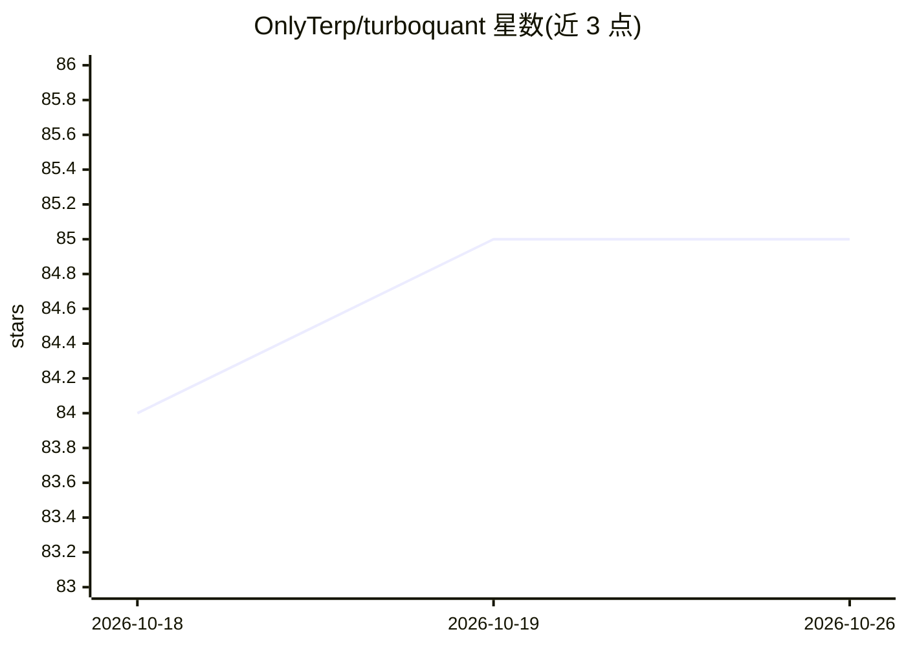

# OnlyTerp/turboquant

⭐ 85 · Python · MIT · 推送 2026-05-25 · [GitHub](https://github.com/OnlyTerp/turboquant) · 个人维护

**Google TurboQuant 论文的开源实现：LLM 推理的 KV cache 量化压缩**

对 Google TurboQuant（ICLR 2026）的开源 PyTorch 实现：通过随机旋转 + 标量 Lloyd-Max 量化器将 KV cache 压缩至 FP16 的 1/3–1/4，无需校准数据，面向 GPU 显存受限的 LLM 服务场景。README 提供调优指南：建议先尝试 FP8、生产用 4bit_nc 变体、QJL 可选关闭等。算法已合入 vLLM 上游，社区存在 PyTorch/MLX/Triton/llama.cpp 等多个移植。以 pip 包与源码两种方式安装，需 Python 3.10+ 与 PyTorch。

## 筛选速览

| 维度 | 判定 | 备注 |
|---|---|---|
| AI 角色 | `ai-ecosystem` | LLM/agent 周边工具 |
| 许可风险 | `permissive` | MIT |
| 部署形态 | `library` | 以包/库形式分发 |
| 模型依赖 | local-ok | 支持本地模型 |
| 硬件要求 | — | 无带数字的原话,不猜 |
| 安装摩擦 | `medium` | 含编译或系统依赖之一 |
| 成熟度 | — | 结构信号不足 |

## 能力要点

- 随机旋转 + 标量 Lloyd-Max 量化，3–4× KV cache 压缩，无需校准数据
- 已合入 vLLM 上游，提供 turboquant_4bit_nc / k8v4 等 dtype 选项
- Hadamard / dense 两种旋转模式，QJL 残差校正可配置开关
- README 汇总第三方复现结果并给出分场景调优建议

## 适用场景

- 单卡跑 70B+ 模型 + 128K 长上下文时压缩 KV cache
- 不支持 FP8 attention 的消费级 GPU / Apple Silicon 上的推理部署
- 边缘设备等严格显存预算下的长上下文推理

## 场景标签

`模型量化` · 领域:训练与推理

## 证据(README 行号)

> L12: **A data-oblivious KV-cache compressor.** Random rotation + scalar Lloyd-Max quantizer
> L16: > Open-source implementation of Google's TurboQuant (ICLR 2026). Provably within 2.7× of the information-theoretic 
> L167: # ... drop into your attention loop; see INTEGRATIONS.md for vLLM / SGLang / llama.cpp

## 星数曲线

2026-10-18 84 → 2026-10-26 85（+1）

---
*卡片 v1 · prompt 1.4 · 生成 2026-10-24 · 置信度 high · 依据 README sha `bc601e124150` · [字段定义](../../DATASET.md)*
