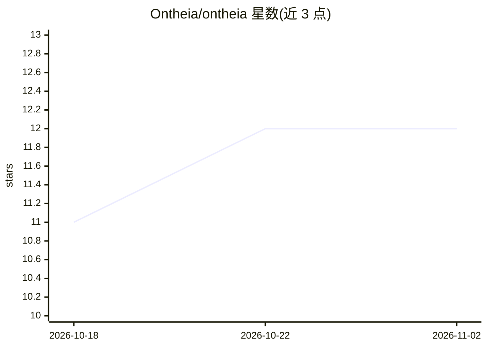

# Ontheia/ontheia

⭐ 12 · TypeScript · AGPL-3.0 · 推送 2026-10-14 · [GitHub](https://github.com/Ontheia/ontheia) · [官网](https://ontheia.ai/) · 组织维护

**自托管多用户 AI agent 平台：多模型接入、MCP、记忆与治理**

面向组织的自托管 AI agent 平台，以 Docker Compose 部署在自己基础设施上。功能包括多 provider 模型接入（Claude/GPT/Gemini/Grok/Ollama 及 OpenAI 兼容模型）、基于 MCP 连接外部工具、可复用 Agent Skills、pgvector 内置 RAG 长期记忆、可视化 Chain Engine 工作流、cron 自动化、agent 间委托协调，以及角色权限与 PostgreSQL 行级安全实现的 GDPR 合规数据治理。安装方式为 curl 一键脚本或 git clone 后 docker compose，REST API 暴露全部功能。AGPL v3 与商业双许可。

## 筛选速览

| 维度 | 判定 | 备注 |
|---|---|---|
| AI 角色 | `ai-native` | 本体是模型或模型工具 |
| 许可风险 | `dual` | AGPL-3.0 |
| 部署形态 | `self-host` | docker 或自建部署 |
| 模型依赖 | local-ok | 支持本地模型 |
| 硬件要求 | — | 无带数字的原话,不猜 |
| 安装摩擦 | `low` | 无编译、无系统依赖或容器化 |
| 成熟度 | — | 结构信号不足 |

## 能力要点

- MCP 原生连接外部工具，多 provider 可切换
- pgvector 内置 RAG，按 episodic/semantic 等类型管理长期记忆
- 可视化 Chain Engine 无代码工作流与 cron 调度
- PostgreSQL 行级安全实现多用户隔离与 GDPR 合规

## 适用场景

- 在自有服务器上为团队部署带权限控制的 AI agent 工作环境
- 让多个专职 agent 委托协作完成复杂任务
- 对数据不出服务器有合规要求的组织内部使用

## 场景标签

`多智能体` `Agent 记忆` `工作流自动化` · 领域:Agent 开发

## 证据(README 行号)

> L1: # Ontheia — the self-hosted AI agent platform
> L9: Most AI setups stay fragmented: separate chats, tools, scripts, and automations with no shared memory, no continuity
> L24: - 🔌 **Multi-provider** — Claude, GPT, Grok, Gemini, Ollama — you choose the model. No lock-in.

## 星数曲线

2026-10-18 11 → 2026-11-02 12（+1）

---
*卡片 v1 · prompt 1.4 · 生成 2026-11-01 · 置信度 high · 依据 README sha `f78888ab0e26` · [字段定义](../../DATASET.md)*
